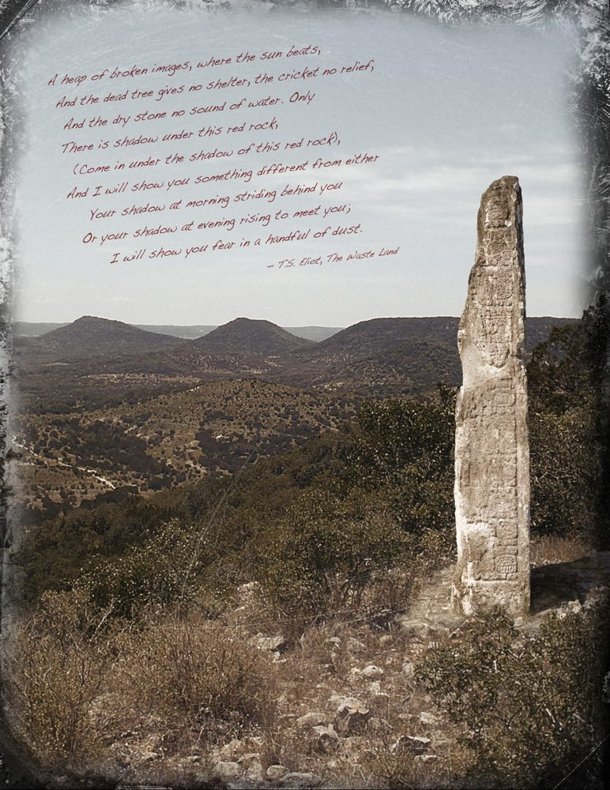

> *Груда разбитых образов, где солнце бьёт,*
> *И мёртвое дерево не даёт тени, сверчок — облегченья,*
> *Сухой камень — ни звука воды. Только*
> *Под этой красной скалой есть тень*
> *(Войди же в тень этой красной скалы),*
> *И я покажу тебе нечто иное,*
> *Чем тень твоя, что утром шагает следом,*
> *Иль тень твоя, что вечером встаёт навстречу;*
> *Я покажу тебе страх в пригоршне праха.*
>
> — Т. С. Элиот, «Бесплодная земля»
