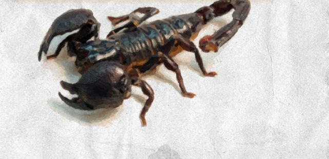

## Опасность пустыни: бесплодные земли

### Давление

Помимо обычного давления — пересечь пустыню как можно быстрее, — в бесплодных землях изобилие ядовитых тварей, из-за которых отдохнуть ночью почти невозможно.

Из-за множества скальных образований, оврагов, каньонов и природных укрытий эти земли облюбовали те, кто бежит от закона и находит убежище там, куда никто в здравом уме за ними не последует. Может быть, сыщики бегут от плена, а может, они преследователи, которым любой ценой надо догнать добычу.

### Если — то

Бесплодные земли куда опаснее, чем кажутся на первый взгляд, и путник легко может расслабиться настолько, что совершит ошибку.

> **Камнепады.** Всякий раз, когда идёшь возле обрыва, под нависающей скалой или через другое скальное образование, есть шанс, что часть камня оторвётся и рухнет на ничего не подозревающих сыщиков.
>
> Если сыщики намеренно не избегают таких мест, каждый час есть шанс 1 из 6, что поблизости оторвутся камни и упадут рядом с группой. Шанс возрастает до 2 из 6, если сыщики сильно шумят, до 3 из 6, если идёт рукопашный бой, и до 4 из 6, если кто-то стреляет или что-то взрывает.
>
> Если сыщики внимательно следят за такими опасностями, они легко избегут камнепада, хотя это замедлит их передвижение процентов на 10 (на усмотрение Хранителя).
>
> Если рядом с сыщиками падает камень, пусть они пройдут проверку Уклонения. Провалившего задевает камнем или обломками, и он получает 1d10 урона. Урон заодно определяет размер камня.
>
> | Урон | Диаметр камня | Дополнительные последствия |
> |---|---|---|
> | 1–2 ПЗ | 15 см | Оглушён на 1 раунд. |
> | 3–4 ПЗ | 30–60 см | Оглушён на 1 раунд и сбит с ног. |
> | 5–6 ПЗ | 60–90 см | Болезненный ушиб: два уровня изнеможения. |
> | 7–8 ПЗ | 1,2–2,5 м | Придавлен камнем. Чтобы выбраться, нужна трудная проверка СИЛ. |
> | 9–10 ПЗ | больше 2,5 м | Критическая травма. Помимо урона, сломана 1 конечность, и ею нельзя пользоваться. При максимальном уроне может понадобиться ампутация (на усмотрение Хранителя). |
>
> **Потеря направления.** В бесплодных землях очень легко потерять ориентацию, хотя примет здесь хватает. Беда в том, что многие приметы очень похожи друг на друга.

Путешествуя по бесплодным землям с множеством высоких скал, сыщики каждый час проходят проверку Ориентирования или Выживания, чтобы убедиться, что не заблудились в этом каменном лабиринте.

Если уж заблудились, найти верную тропу может быть трудно: на это уходит не меньше часа и нужна трудная проверка Ориентирования или Выживания, чтобы вернуться на путь.

Те, кто хоть что-то знает о пустынях такого типа, получают на эту проверку бонусную кость.

Если сыщики просто идут в общем направлении — например, строго на восток, — надолго они вряд ли заблудятся. В этом случае проваленная проверка означает, что они упираются в тупик или другое препятствие, которое заставляет их вернуться по своим следам и потерять 1 час драгоценного времени.

**Ядовитые твари.** В пустынных бесплодных землях пугающе много ядовитых насекомых, рептилий и других экзотических существ. Днём сыщики вряд ли наткнутся на кого-то из них, если только не добывают еду и воду. Ведь добывать — значит заглядывать в прохладные места и переворачивать камни, а именно там многие из этих тварей прячутся днём.

Если у сыщика при добывании выпадает критический провал или успех из таблицы «Провалы и криты», он случайно наткнулся на ядовитую тварь, и его укусили или ужалили.

Ночью всё становится куда опаснее. Сыщики могут снизить риск, потратив дополнительное время на устройство лагеря и расчистив камни и мусор, под которыми могут прятаться ядовитые твари. Если сыщики знают об опасности, это довольно безопасно. Если нет — считайте это добыванием.

Если ночью место расчищено и горит костёр, вероятность, что какая-нибудь ползучая гадость укусит или ужалит сыщика, — 1 из 20. Если костра нет и лагерь устроен плохо — 3 из 20.

Укушенный или ужаленный сыщик проходит проверку Удачи. При провале он проходит проверку ВЫН, иначе получает 1d3 урона от яда.

По желанию Хранитель может решить, что выпавшая на проверке 1 означает смертельную дозу яда: если сыщик не получит противоядия, он теряет 1d4 ПЗ каждый час, пока не умрёт.

В аптечке, купленной в окрестностях пустыни, скорее всего, будет противоядие, способное спасти жизнь, — без всякой проверки.

Хранитель может счесть смертельный укус или укол жала слишком жестоким и просто заменить его эффект уровнем изнеможения на день-два.

