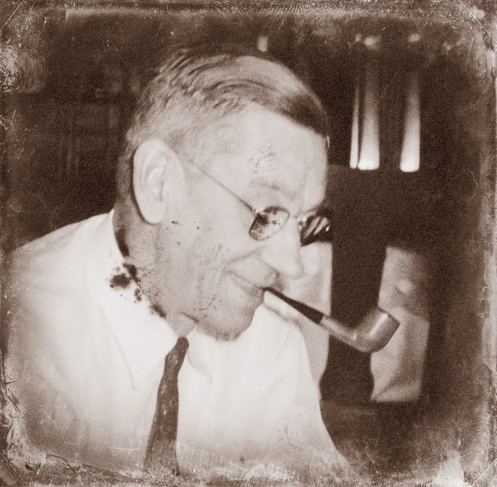

…и соответственно направлять дастбилли. Остин проводит этот ритуал в церкви: чтобы следить за чужаками, он гадает по медной чаше, наполненной человеческой кровью.

**Угроза Усадьбе.** Если сыщики устроят неприятности в Усадьбе и дела у дастбилли пойдут плохо, Остин выпустит из колодца Порождение Йига, чтобы оно убило всех чужаков в стенах компаунда.

**Личины.** Тиларисш в прошлом поглотил несколько обличий и может по желанию превращаться в любое из них. Среди них — девочка (8 лет), мальчик (5 лет) и, конечно, настоящий преподобный Остин. Раз уж он выдаёт себя за Остина, большую часть времени он проводит в этом облике. Другие личины он использует, чтобы подобраться к сыщикам, если ему нужны сведения, чтобы куда-нибудь их завести, скормить им ложные сведения или вывести их из строя шприцем конского транквилизатора.

Если дастбилли удастся схватить одного из сыщиков раньше остальных, его отведут к Остину, и тот проведёт ритуал: отсечёт пленнику ведущую руку чуть ниже локтя, обратит её в «основные соли» и поглотит. Это разновидность заклинания «Поглощение образа»; так Остин сможет выглядеть в точности как этот сыщик. Изувеченного сыщика подвесят (живым) на мясной крюк на бойне (см. место 14m) — дожидаться разделки.

В новой личине Остин разыщет остальных сыщиков и скажет, что сбежал. Затем он попытается заманить их в ловушку. Если кто-то заподозрит неладное, он призовёт бьякхи, чтобы тот напал на сыщиков и унёс его (Остина) обратно в Усадьбу.

**Последнее средство.** Если кому-то удастся выбраться к шоссе, зная его тайны, Остин призовёт бьякхи, чтобы тот выследил беглецов, прежде чем они доберутся до помощи.

## Доктор Роберт Л. Бреннер



Роберт Бреннер (он же «Док Боб») на самом деле учился на ветеринара, и медицинского диплома у него нет. Он глубоко связан с дастбилли и по власти уступает только Остину. С чужаками он играет дружелюбного старого сельского доктора, чтобы усыпить их бдительность, но на самом деле он — мозг всего городка. По сути, его дело — присматривать за порядком. Если он видит, что ребята (дастбилли) вот-вот наделают не тех неприятностей, он вмешается и разрядит обстановку, выглядя скорее спасителем, чем злодеем.

Разумеется, если кто-то из сыщиков станет слишком беспокойным и (или) будет явно не склонен участвовать в *Охоте*, Бреннер может просто усыпить его, пока тот стоит спиной.

Хранителю стоит помнить, что доктор Бреннер — очень умный психопат, по сути серийный убийца, и недооценивать его нельзя.

```stat
Доктор Роберт Л. Бреннер
СИЛ 55    ВЫН 50    ТЕЛ 65    ЛВК 45    ИНТ 80    МОЩ 45
ПЗ 11     Средний БкУ: 0     Средняя Комплекция: 0     СКО 7

АТАКИ
Атак за раунд: 1
Ближний бой: Драка 30%; Стрельба (пистолет) 35%;
Стрельба (винтовка/дробовик) 45%; Уклонение 25%
Броня: 0
Навыки: Обаяние 45%, Мифы Ктулху 15%, Запугивание 55%, Красноречие 55%, Первая помощь 55%, Медицина (человека) 35%, Медицина (ветеринария) 45%, Психология 50%, Внимание 45%
Заклинания: нет
```

### Поведение и тактика доктора Бреннера

На людях Бреннер всегда изображает доброго сельского доктора — на случай, если кто-то смотрит. Маску он сбрасывает только у себя дома или в Усадьбе.

Он всегда носит при себе три шприца сильного снотворного (см. с. 77) — на случай неприятностей. Сразу за входной дверью его дома стоит дробовик 12-го калибра — для незваных гостей.
