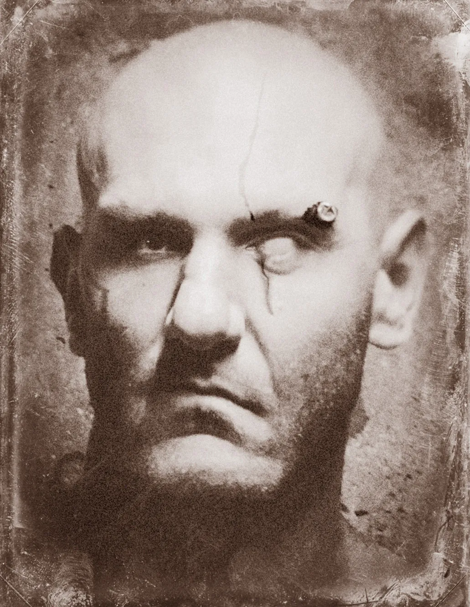

## Сет



Самого заметного из дастбилли зовут Сет, и он один из самых способных. А заодно и самый психопатичный: он упивается мучениями других. Сет поджарый, мускулистый и весь покрыт ритуальными шрамами. Лицо и тело у него в татуировках — латинских стихах из «De Vermis Mysteriis». Самая заметная наколота красными буквами поперёк груди: SAPIENTIA ET MORS IAM NON CECIDIT RÉGIS CONCESSA FUIT ALIQUA TENUIT TENEBRIS.

Через всё лицо и голову у него тянется рваный шрам. Блеск металла оказывается болтом, который будто ввинчен в левую часть лба. Сделано ли это для устрашения или это грубая попытка скрепить череп после давней травмы — неясно.

Сет говорит мало, но от его взгляда стынет кровь. Своими людьми он правит с абсолютной жестокостью: у нескольких из них не хватает пальцев — он отрезал их в наказание за провал. Сет — законченный фанатик, всецело преданный Остину, которого считает своим истинным отцом.

### Поведение и тактика Сета

Сет всецело предан преподобному Остину и видит в нём едва ли не полубога. Остина и Бреннера он слушается беспрекословно, но больше никого слушать не станет.

Впрочем, иногда он даёт волю гневу, и его приходится сдерживать, если его поступки угрожают *Охоте* или *Усадьбе*. Любого другого дастбилли за иные его выходки скорее всего убили бы, но Остин ценит его умения.

С будущими жертвами Сет всегда сначала пытается их усмирить — одним из особых шприцев Дока Бреннера или просто оглушив. Если кого-то из его ребят ранят или убьют, Хранителю следует сделать за Сета проверку МОЩ: при провале он впадает в ярость и пытается убить обидчиков.

В кармане у Сета — кожаная дубинка («сап»), под сиденьем — два шприца снотворного (см. с. 77). За поясом, за спиной, заткнут револьвер .38 — на случай, если без убийства не обойтись.

Под сиденьем его пикапа лежит обрез двуствольного ружья с двумя патронами. Ещё дюжина патронов к нему и коробка с двадцатью патронами к револьверу — в бардачке.

```stat
Сет
Хар-ка   Среднее   Бросок
СИЛ        80      (3d6+6)×5
ВЫН        50      (3d6+1)×5
ТЕЛ        85      (3d6+2)×5
ЛВК        75      (1d6+12)×5
ИНТ        45      3d6×5
МОЩ        45      3d6×5
ПЗ: 13
Средний БкУ: +1d6
Средняя Комплекция: 1
СКО: 9

АТАКИ
Атак за раунд: 1
Ближний бой: Драка 50%; Топор 55%; Уклонение 50%
Броня: 1 очко от загрубевшей кожи (см. ниже)
Навыки: Лазание 35%, Вождение автомобиля 55%, Прыжки 45%, Внимание 35%, Выживание 45%, Метание 45%
Потеря Рассудка: жертва пыток может потерять 0/1d4 Рассудка.
Пытки: когда жертва в руках дастбилли, они часто пытают её забавы ради, нанося 1 пункт урона за удар. После каждого удара жертва проходит проверку ВЫН, чтобы не потерять сознание от боли. При успехе она остаётся в сознании, при чрезвычайном успехе ей удаётся избежать этого пункта урона. При провале она теряет сознание.
Загрубевшая кожа: Остин с помощью магии из «De Vermis Mysteriis» дал Сету некоторую защиту от ран. Это даёт ему 1 очко брони. Сразу это незаметно — тело Сета покрыто татуировками, и некоторые из них — часть защитной магии.
```

*Прим. перев.: так в оригинале — при СИЛ 80 и ТЕЛ 85 (бонус к урону +1d6) Комплекция должна быть 2, а не 1; Скорость при СИЛ и ЛВК меньше ТЕЛ — 7, а не 9; ТЕЛ 85 не соответствует броску (3d6+2)×5 (в среднем около 60).*
