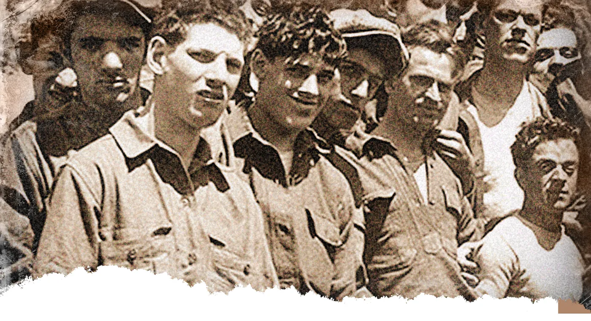

## Дастбилли

> *Они превратились в особое племя, с явными душевными и телесными клеймами вырождения и кровосмешения. Умом они в среднем прискорбно скудны, а их летописи смердят откровенной злобой и полускрытыми убийствами, кровосмешением и деяниями почти неописуемого насилия и извращения.*
>
> — Г. Ф. Лавкрафт, «Ужас Данвича»

Дастбилли — по сути инбредные деревенщины-мутанты. А значит, как и любому человеку, им нужно есть, спать и справлять нужду. Это значит также, что убить их можно, как любого другого. Отличаются они тем, что уродства сделали их сильнее и быстрее обычного человека, но вместе с тем они крайне тупы и склонны к насилию и фанатизму. Преподобный Остин сумел воспользоваться их слабостями и сплотить их в грозный культ.

Большинство дастбилли более или менее одинаковы, но есть несколько исключений, описанных ниже. В отдельных случаях Остин даровал особые блага ученикам, проявившим особенно ревностную преданность. Блага эти ограниченны, но всё же делают таких дастбилли особенно опасными.

```stat
Дастбилли (типичный)
Хар-ка   Среднее   Бросок
СИЛ        80      (3d6+6)×5
ВЫН        50      (3d6+1)×5
ТЕЛ        45      3d6×5
ЛВК        75      (1d6+12)×5
ИНТ        30      2d6×5
МОЩ        45      3d6×5
ПЗ: 9
Средний БкУ: +1d4
Средняя Комплекция: 1
СКО: 9

АТАКИ
Атак за раунд: 1
Ближний бой: Драка 50%; Стрельба (пистолет) 30%;
Стрельба (винтовка/дробовик) 35%; Уклонение 45%
Броня: нет
Навыки: Лазание 35%, Вождение автомобиля 45%, Прыжки 45%, Внимание 35%, Выживание 40%, Метание 35%
Потеря Рассудка: жертва пыток может потерять 0/1d4 Рассудка.
Нокаут: если дастбилли пытается взять кого-то живым, как на их ритуальной Охоте, Хранителю следует применять правило нокаута («Книга хранителя», с. 125). Разумеется, если кто-то стал слишком опасен или убил одного из дастбилли, они наносят обычный урон.
Пытки: когда жертва в руках дастбилли, они часто пытают её забавы ради, нанося 1 пункт урона за удар. После каждого удара жертва проходит проверку Выносливости, чтобы не потерять сознание от боли. При успехе она остаётся в сознании, при чрезвычайном успехе ей удаётся избежать этого пункта урона. При провале она теряет сознание.
```

> **Заметки Хранителя**
>
> На Охоте дастбилли редко пользуются огнестрельным оружием, но обращаться с ним, конечно, умеют. Они ведь живут в Техасе. Обычно они предпочитают драться вблизи — ножами, мясными крюками и дубинками.
