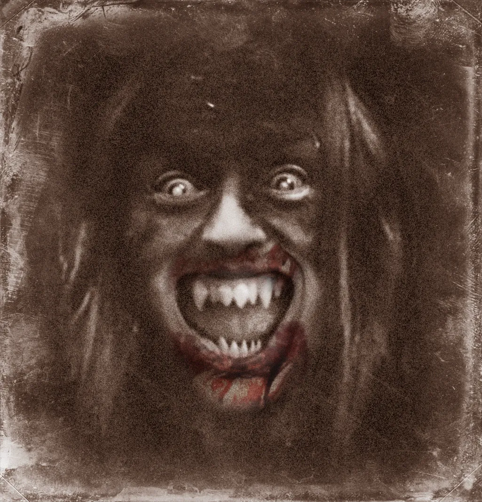

# Приложение IV. Чудовища

## Тейхиихан

***Мифы.*** Тейхиихан занимают видное место в фольклоре арапахо и других соседних коренных народов Северной Америки. Говорят, в далёком прошлом с этими жуткими созданиями сражались много раз, и потому они стали обычными противниками во многих сказаниях о героях и воинах.

Их описывали как уродливых, кровожадных человекоподобных существ ростом с ребёнка, с заострёнными зубами, тёмной кожей, которая могла менять цвет, скрывая их от глаз, и кошачьими глазами. В сказаниях они не слишком умны, хотя в большинстве рассказов это умелые охотники, способные пользоваться простыми орудиями и оружием.

Несмотря на малый рост, они, по преданиям, были необычайно сильны и проворны и могли одолеть любого, кроме самых хитроумных воинов. Их главной слабостью был недостаток ума, поэтому их легко мог провести тот, кто быстро соображает и не теряет головы.

***Факты.*** Многое из того, что фольклор коренных народов говорит о тейхиихан, довольно точно, но ни одно предание не открывает, что тейхиихан на самом деле созданы змеелюдьми.

Тейхиихан — плод чудовищных опытов над человеческими детьми: их выбирали потому, что дети податливее и легче поддаются порче. Подопытных змеелюди добывали в окрестных племенах, нередко истребляя при этом целые деревни.

После бессчётных неудачных попыток они наконец разработали состав и процедуру, которые давали достаточно высокую долю успеха, чтобы игра стоила свеч. В итоге появился ритуал «Порча людоеда» (см. приложение V, с. 96), который мучительно превращает человеческих детей от 8 до 12 лет в тейхиихан. Разумеется, процедура удавалась не всегда, и неудачные попытки оставляли несчастного ребёнка искорёженным и изуродованным — и, к несчастью, живым.

***Способности.*** Внешностью и способностями они во многом похожи на тех, кого описывают предания. Их кожа сходна по свойствам с кожей некоторых головоногих: они могут менять её цвет и фактуру. Это позволяет им почти идеально сливаться с окружающей местностью. Чувства у них чрезвычайно острые: они видят в кромешной тьме, чуют запах за много километров и слышат малейший звук. Разумеется, эти же чувства могут стать уязвимостью, когда их захлёстывает яркий свет, громкий шум или резкий запах.

***Внешность.*** Тейхиихан выглядят как смуглые мускулистые дети с длинными спутанными чёрными волосами. Лица у них неестественно искажены лишними мышцами и костями, которые дают им невероятную силу укуса. Одежду они носят редко, но определить их изначальный пол невозможно: в ходе жуткого превращения половые органы исчезают. У них острые, как у хищника, зубы и зазубренные жёлтые когти, которыми они хватают и рвут плоть добычи.

***Поведение и тактика.*** Тейхиихан не слишком умны, но далеко не «тупые звери». Обычно они охотятся втроём, но если угроза достаточно серьёзна, могут действовать и большими группами. Аль’иссе Сс’рисси А’не они подчиняются беспрекословно и по её слову без колебаний пойдут на смерть.

На охоте тейхиихан часто подкрадываются к добыче с разных сторон, стараясь отрезать все пути к бегству. Обычная тактика — один тейхиихан гонит добычу в засаду, где ждут остальные. Этот способ охоты дастбилли переняли для своей *Охоты*.

Если тейхиихан пытаются поймать сбежавших жертв, они бьют их дубинками до потери сознания. Хранителю следует применять правило нокаута из «Книги хранителя» (с. 125).

С другой стороны, если их послали вернуть книгу «De Vermis Mysteriis», они сделают это любой ценой. Если подвернётся случай взять сыщика живым, они им воспользуются, но скорее просто убьют любого, кто встанет на пути, — так быстрее. Жрица ясно дала понять, что возвращение книги важнее всего остального.

***Уязвимости.*** Тейхиихан превосходно выполняют указания, но плохо импровизируют, если…
