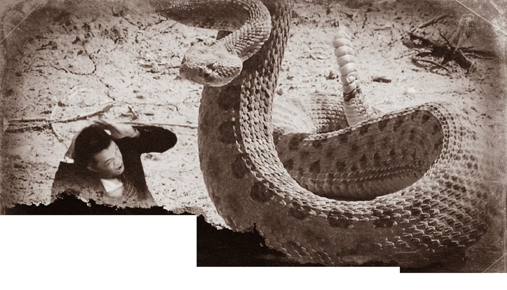

## Порождение Йига

> *Движущееся существо было почти в человеческий рост и совершенно без одежды. Оно было абсолютно безволосым, а его рыжевато-бурая спина в тусклом, могильном свете казалась слегка чешуйчатой. На плечах оно было пятнистым и буроватым, а голова — на редкость плоской. Когда оно подняло голову, чтобы зашипеть на меня, я увидел, что маленькие чёрные глазки-бусинки были проклято человекоподобны, но долго разглядывать их я не мог. Они впились в меня с жуткой настойчивостью, и я, задыхаясь, захлопнул заслонку и оставил тварь извиваться невидимой в спутанной соломе и призрачных сумерках.*
>
> — Г. Ф. Лавкрафт, «Проклятие Йига»

Порождения Йига — непристойное потомство Йига и человека. Они могут нести черты обоих родителей, но часто выглядят как огромный змей почти 12 м длиной и весом больше 450 кг. Эти твари чешуйчатые и змееподобные, с иссохшими рудиментарными конечностями, которые бесполезно болтаются на теле. Лицо часто сохраняет смутно человеческие черты, но глаза всегда холодные и без век. Над землёй Порождения Йига показываются редко: они предпочитают тёмные подземелья. Если такую тварь убить, её тело быстро разлагается, оставляя липкую чёрную слизь, облепленную тучами мух.

```stat
Порождение Йига
Хар-ка   Среднее   Бросок
СИЛ       120      (5d6+6)×5
ВЫН       120      (5d6+6)×5
ТЕЛ       115      (5d6+5)×5
ЛВК       120      (4d6+12)×5
ИНТ        65      (2d6+6)×5
МОЩ        55      3d6×5
ПЗ: 24
Средний БкУ: +2d6
Средняя Комплекция: 3
СКО: 9

АТАКИ
Атак за раунд: 1
Ближний бой: Заглатывание 35% (урон 1d10 + 1d10 за раунд от сдавливания, удушья и желудочной кислоты, пока жертва не умрёт или её не извлекут); Сокрушающее сжатие 20% (урон 1d6+БкУ); Укус 30% (урон 1d6 + яд); Уклонение 60%
Броня: 2 очка — чешуйчатая кожа
Навыки: Слух 50%, Скрытность 70%, Плавание 70%
Потеря Рассудка: 2/2d4+1
Заглатывание: Порождения Йига атакуют, высоко подняв голову, а затем бьют, как обычные змеи. Обычно они проглатывают жертв и могут проглотить до 20 существ размером с человека.
Яд: укушенный Порождением Йига проходит проверку ВЫН. При чрезвычайном успехе урон уменьшается вдвое, иначе жертва получает 2d10 урона от яда. Если укушенный выживет, он остаётся в полузабытьи и до 12 часов страдает от болей в животе, рвоты, поноса, озноба, пота, судорог, желтухи, сбоев сердечного ритма, нарушений зрения и конвульсий.
   Противоядия от этого яда нет, хотя немедленная трудная проверка Первой помощи или Медицины может вдвое сократить время действия яда. В особых обстоятельствах Хранитель может позволить стряхнуть действие яда, если проверка ВЫН дала критический успех.
```
