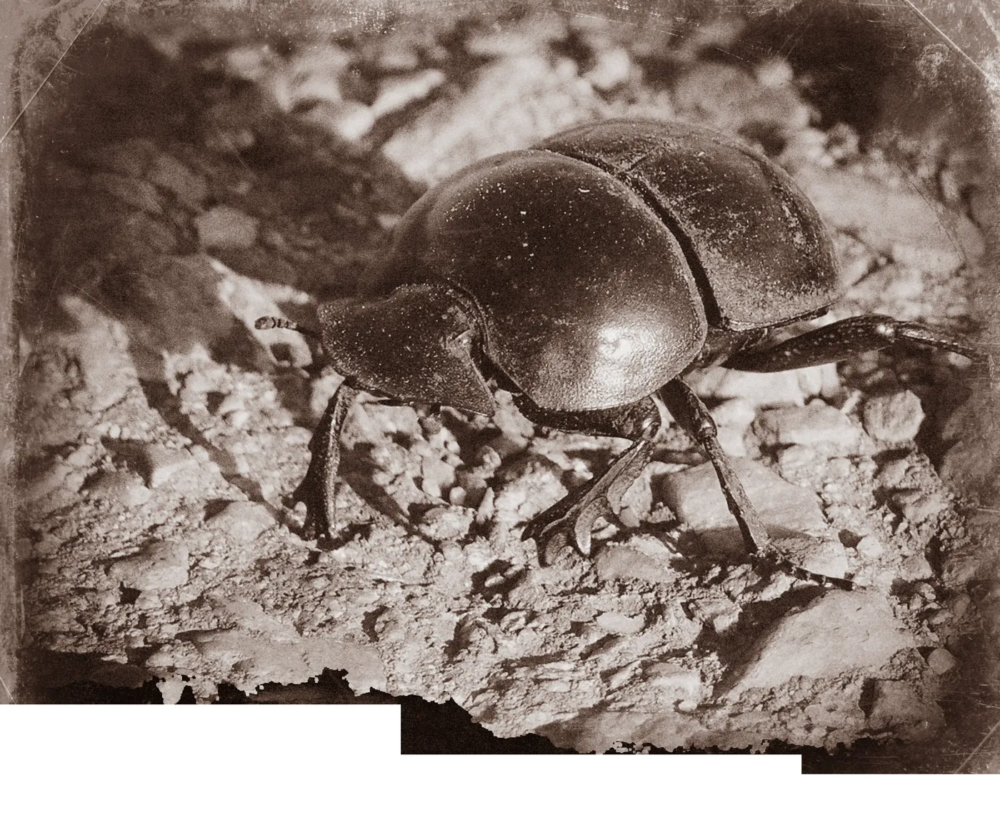

## Рой металлических жуков

Эти жуки длиной около 8 см будто сделаны из тёмного живого металла, с ржавчиной по краям. Их создали бессчётные эпохи назад змеелюди, чтобы очищать свои пещеры от органики и изредка забредающих незваных гостей. Каждый жук питается от осколка зелёного камня, черпающего силу из магнитного поля Земли, поэтому его никогда не нужно менять.

На коротких расстояниях металлические жуки переговариваются друг с другом ультразвуковыми щелчками. Это позволяет им роем облеплять любую органику и за считаные минуты обращать её в порошок.

Думать металлические жуки не могут, но в них заложены простейшие указания: куда идти, что разлагать и что змеелюдей нужно избегать. Эта защита распространяется и на тейхиихан, которые выделяют феромоны змеелюдей.

```stat
Рой металлических жуков
СИЛ 35    ВЫН 55    ТЕЛ 35    ЛВК 70
ПЗ: 10 (каждый рой состоит из 10 металлических жуков. Любая удачная атака уничтожает 1d3 жуков, уменьшая ПЗ роя на столько же.)
БкУ: −1
Комплекция: −1
СКО: 9

АТАКИ
Атак за раунд: 1
Ближний бой: Укус 30% (урон 1d3); Уклонение 30%
Захлёстывание (манёвр): роем металлические жуки могут наброситься на одного человека и захлестнуть его по правилам манёвров; благодаря численности они получают бонусную кость к атаке. Такая атака — рой облепляет цель, кусая и царапая. Удачная атака повышает урон до 1d6.
Броня: хотя жуки металлические, они не слишком прочны, поэтому брони у них не считается. Огонь им не страшен.
Рассудок: 0/1
```
