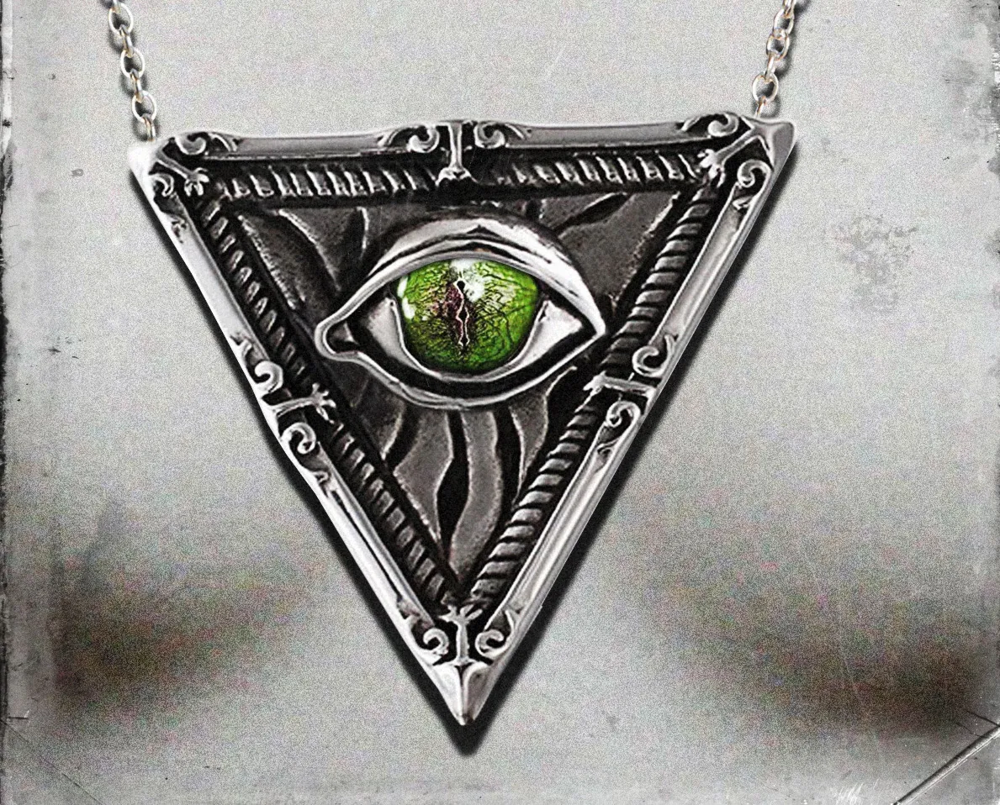

# Приложение V. Прочее

## Новые заклинания

### Слепящая плоть

- Цена: 2 пункта магии; 1d3 Рассудка
- Время сотворения: мгновенно

Это заклинание ослепляет цель самым ужасным из возможных способов. Чтобы оно подействовало, заклинатель должен находиться не дальше 10 м от цели и победить её во встречной проверке МОЩ. При успехе плоть вокруг глаз жертвы начинает быстро разрастаться и затягивать глазницы, за 10 секунд полностью закрывая глаза. Жертва полностью слепнет.

Процесс жуткий и болезненный. Цель и все свидетели проходят проверку Рассудка (1/1d6). При провале проверки Рассудка жертва, скорее всего, выронит всё, что держит, и станет беспомощно ощупывать своё теперь безглазое лицо.

Хотя кожа, затянувшая глаза, и ослепляет жертву, зрение технически не повреждено. Плоть можно разрезать, чтобы жертва снова видела, но, если это делает не опытный хирург, разрез наносит 1d4 урона, а моргать и закрывать глаза человек уже не сможет. В современности искусный пластический хирург способен вернуть 90% прежней функции и внешности.

### Порча людоеда

- Цена: 5 пунктов магии; 1d8 Рассудка
- Время сотворения: 1d3 часа

Навсегда превращает человеческого ребёнка в тейхиихан.

Жертву заклинания нужно накормить не меньше чем 0,5 кг плоти умершего родственника, причём кормление не обязательно должно быть добровольным. Съев плоть, жертва должна запить её примерно 0,5 л крови того же родственника, смешанной с напёрстком крови заклинателя. Кровь тоже не обязательно пить добровольно. Всё кормление сопровождается песнопениями и плясками тейхиихан; их могут исполнять несколько человек (минимум двое — барабанщик и танцор), кроме самого заклинателя, который должен подавать жертве плоть и кровь.

Перед ритуалом кормления жертву нужно подготовить: она должна вытерпеть не меньше трёх дней мучительной боли. Тейхиихан предпочитают подвешивать жертву на больших крюках, продетых через мясистые части тела или кожу спины. Всё это время жертву не кормят и дают лишь столько воды, чтобы она не умерла. В последние 24 часа перед завершением ритуала воды не дают вовсе. С начала пыток жертва теряет 1d4 Рассудка в час. Если это не сводит её с ума окончательно (Рассудок 0), то последнее, что осталось, теряется, когда начинается превращение.

После того как плоть и кровь съедены, заклинатель присоединяется к песнопениям и пляскам, а жертва корчится от боли на земле. За следующие 1d6 часов её тело меняется: кости рук ломаются и удлиняются, мышцы растягиваются и растут, зубы удлиняются (позже их сточат в форму кинжалов, которую любят тейхиихан), кожа сходит, открывая под собой новую плоть тейхиихан. Процесс мучителен, и до конца превращения жертва может лишь выть, свернувшись клубком. Разум жертвы сломлен, она ничего не помнит о прежней жизни — теперь это всего лишь новорождённый тейхиихан, которого надо научить обрядам, обычаям и языку его нового народа.

## Новые предметы

### Око Йига

Этот древний кулон создали змеелюди в незапамятные времена. Изначально он умножал знания носителя и помогал ему лучше сосредоточить силу разума. Однако со временем он сохранил отпечатки тех, кто им пользовался, а поскольку создан он был для змеелюдей, с нервной системой человека он не вполне совместим.

**Действие.** Если сыщик надевает Око Йига, он сразу теряет 2d6 Рассудка. Пока кулон надет, он даёт носителю следующие способности: Мифы Ктулху 40%, *Приказ Кровавого языка* (Grand Grimoire, с. 69), *Отражение вреда* (Grand Grimoire, с. 93), *Покорение* (Grand Grimoire, с. 98) и *Благословение Йига* (Grand Grimoire, с. 127). Человек, носящий кулон, теряет 1d4 ВЫН каждые 10 минут, пока не снимет его или не умрёт. Эта потеря необратима.
