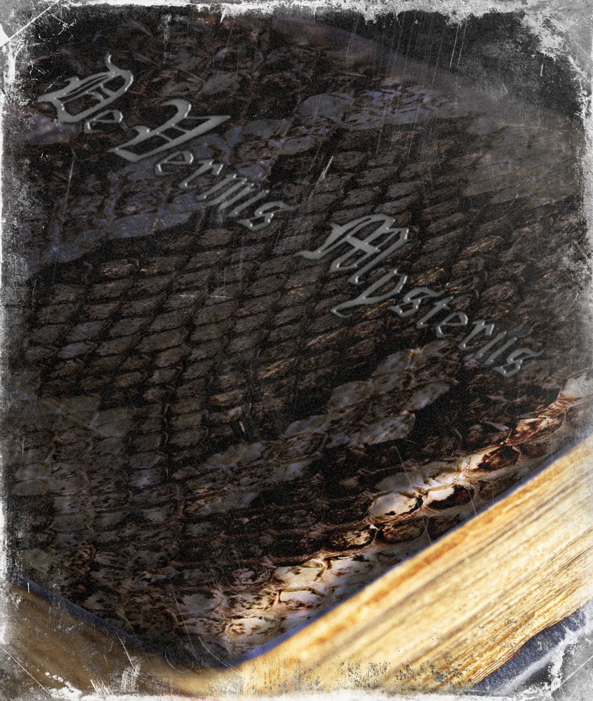
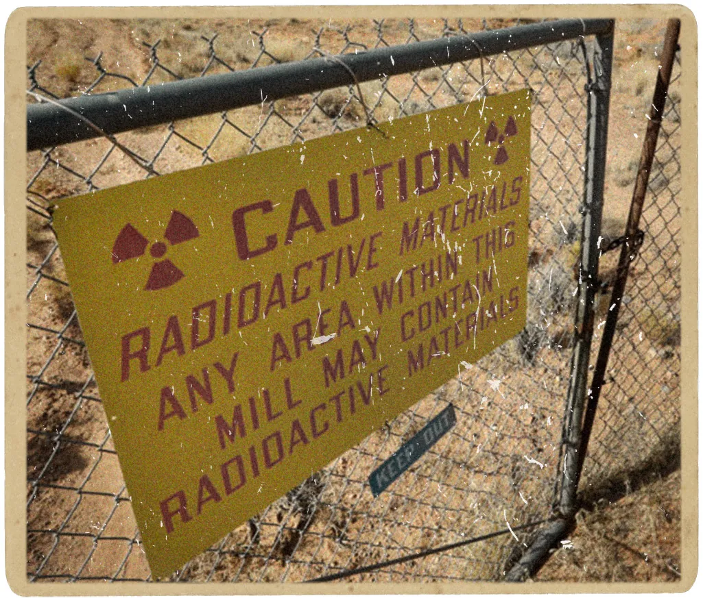

### De Vermis Mysteriis

*Латынь, преподобный Иезекииль Холгейт, 1932*

У этого уникального издания книги обложка из чёрной змеиной кожи с серебряными буквами: «De Vermis Mysteriis». Его создал в 1932 году пятидесятнический проповедник Иезекииль Холгейт в том краю Западного Техаса, что зовётся Хребтом Дьявола. Холгейта заманила в пустыню змеиная жрица Йига, которая передавала через него знание. Преподобный лихорадочно работал над книгой — материалами, которые она ему давала, и собственной кровью вместо чернил. Последним шагом он расплавил своё распятие и залил жидкий металл в желобки на обложке, которые сложились в буквы заглавия. Это едва его не убило.

Холгейт пользовался книгой со своими прихожанами, пока всех их не убили Аль’исса Сс’рисси А’на и её прислужники-тейхиихан.

- Потеря Рассудка: 2d6
- Мифы Ктулху: +4/+8 процентных пунктов
- Значение Мифов: 36
- Изучение: 48 недель
- Предлагаемые заклинания: *Связь с божеством: Йиг*, *Создать гадальное окно*, *Создание зомби*, *Воззвание к демону* (*Призыв/укрощение бьякхи*), *Воззвание к Дитяти Козы* (*Призыв/укрощение тёмной молоди*), *Воззвание к Невидимому слуге* (*Призыв/укрощение звёздного вампира*), *Перенос разума*, *Вурский знак*
- Особые свойства: тот, кто впервые смотрит на эту книгу, проходит проверку МОЩ. При успехе его охватывает волна лёгкой тошноты и головокружения. При чрезвычайном успехе он чувствует безотчётное желание коснуться её — без всякой разумной причины.

> **Заметки Хранителя**
>
> Если кто-то коснётся книги, он проходит ещё одну проверку МОЩ с бонусной костью. При успехе он тут же слышит в голове змеиный женский голос: «Я ссссвижу тебя». С этого мига Аль’исса Сс’рисси А’на знает, что он причастен к книге, и захочет поговорить с ним лично. Она известит об этом Остина и призовёт двух обитателей песков, чтобы те нашли и вернули книгу.

## Новые правила

### Радиоактивные материалы (пыль и вода)

Радиоактивный материал можно обнаружить счётчиком Гейгера на расстоянии до 10 м. Тот, кто касается такого материала, проходит проверку ВЫН; при провале он теряет 1d4 ВЫН. Без обеззараживания проверку нужно повторять каждый час. Если человек остаётся в контакте с материалом, проверки проходят со штрафной костью. Когда ВЫН падает до половины обычного значения, у жертвы появляются признаки лучевой болезни. При ВЫН 0 жертва умирает.

**Обеззараживание.** Возможности сыщиков обеззаразить себя ограниченны. Лучшее, что они могут сделать, — сбросить заражённую одежду и обтереться незаражённой землёй или песком. Одежду и любые другие пористые материалы обеззаразить нелегко, а в таких условиях — и подавно.

**Признаки лучевой болезни.** Самые частые ранние признаки лучевой болезни — тошнота, рвота и понос, позже появляются волдыри или язвы. От облучения могут выпадать волосы, и иногда это облысение остаётся навсегда.

