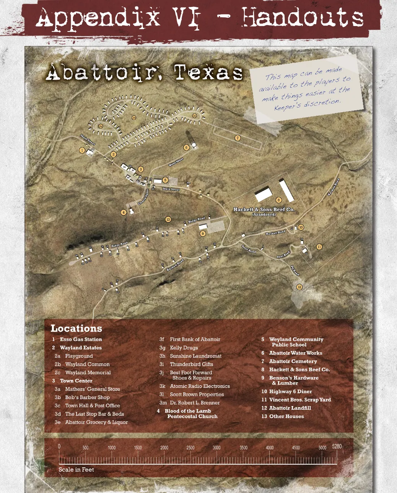

# Приложение VI. Раздатка

## Раздатка 1

> **Раздатка 1: карта Абаттуара**
>
> **Абаттуар, Техас**
>
> *Записка на карте:* «Эту карту можно дать игрокам, чтобы упростить игру, — на усмотрение Хранителя».
>
> **Места**
>
> 1. Заправка «Эссо»
> 2. «Уэйленд-Эстейтс»: 2a — детская площадка; 2b — общий двор «Уэйленд»; 2c — мемориал «Уэйленд»
> 3. Центр городка: 3a — универсальный магазин Мэзерса; 3b — парикмахерская Боба; 3c — ратуша и почта; 3d — бар и мотель «Последняя остановка»; 3e — бакалея и винный магазин Абаттуара; 3f — Первый банк Абаттуара; 3g — аптека Келли; 3h — прачечная «Саншайн»; 3i — сувениры «Громовая птица»; 3j — обувь и ремонт «Твёрдый шаг»; 3k — радиоэлектроника «Атомик»; 3l — «Скотт Браун пропертиз»; 3m — доктор Роберт Л. Бреннер
> 4. Пятидесятническая церковь «Кровь Агнца»
> 5. Общественная школа «Уэйленд»
> 6. Водопровод Абаттуара
> 7. Кладбище Абаттуара
> 8. Мясокомбинат «Хэкетт и сыновья»
> 9. Скобяные товары и лесоматериалы Бенсона
> 10. Закусочная «Шоссе 6»
> 11. Свалка братьев Винсент
> 12. Свалка мусора Абаттуара
> 13. Прочие дома
>
> *Масштаб в футах: 0–5280 (1 миля ≈ 1,6 км).*

*Прим. перев.: так в оригинале — в ключе карты место 3b названо «Bob’s Barber Shop» (парикмахерская Боба), а в тексте сценария это парикмахерская Тома (Tom’s Barber Shop).*
