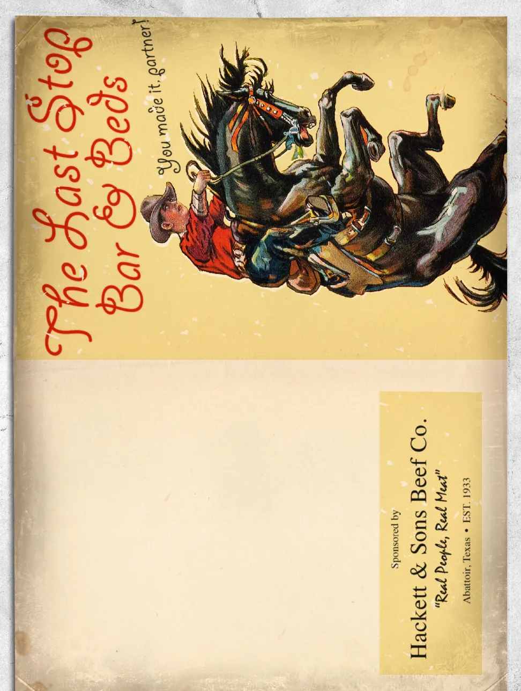

## Раздатка 2 — снаружи

> **Раздатка 2: меню «Последней остановки» (снаружи)**
>
> **Бар и мотель «Последняя остановка»**
>
> *Добрался-таки, партнёр!*
>
> Спонсор — мясная компания «Хэкетт и сыновья»
>
> *«Настоящие люди, настоящее мясо»*
>
> Абаттуар, Техас • осн. 1933
