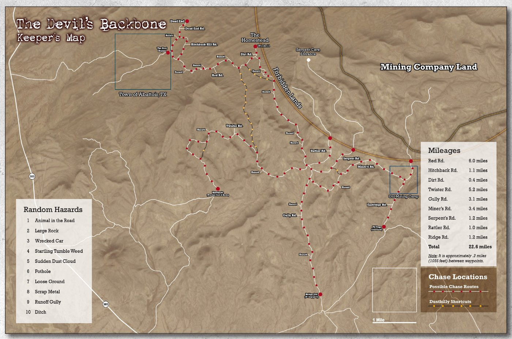
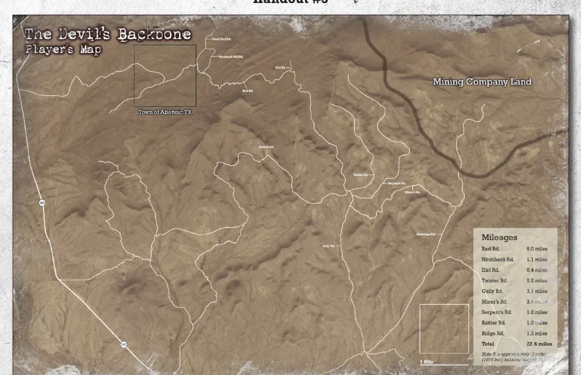

## Раздатка 3

> **Раздатка 3: Хребет Дьявола — карта Хранителя**
>
> *Подписи на карте:* городок Абаттуар, Техас; Дэд-Энд (тупик) и Дэд-Энд-роуд; Хитчбэк-Хилл-роуд; «Здесь начинается Охота»; Ред-роуд; Дёрт-роуд; Усадьба (ветряк); вход в Змеиные пещеры; Запретные земли; земли горнодобывающей компании; Твистер-роуд; заграждение (разбитые машины и камни); Раттлер-роуд; Серпентс-роуд; Майнерс-роуд; Галли-роуд; мост разрушен (овраг глубиной 9 м); старый шахтёрский посёлок; Истридж-роуд; яма-ловушка (замаскирована); шоссе 385; «Опасность» — у отмеченных точек маршрута. Масштаб: 1 миля (1,6 км).
>
> **Случайные опасности**
>
> | 1d10 | Опасность |
> |---|---|
> | 1 | Животное на дороге |
> | 2 | Большой камень |
> | 3 | Разбитая машина |
> | 4 | Внезапное перекати-поле |
> | 5 | Внезапное облако пыли |
> | 6 | Выбоина |
> | 7 | Рыхлый грунт |
> | 8 | Металлолом |
> | 9 | Промоина |
> | 10 | Кювет |
>
> **Протяжённость дорог**
>
> | Дорога | Длина |
> |---|---|
> | Ред-роуд | 9,6 км |
> | Хитчбэк-роуд | 1,8 км |
> | Дёрт-роуд | 0,6 км |
> | Твистер-роуд | 8,3 км |
> | Галли-роуд | 5 км |
> | Майнерс-роуд | 5,4 км |
> | Серпентс-роуд | 1,9 км |
> | Раттлер-роуд | 1,6 км |
> | Ридж-роуд | 1,9 км |
> | **Всего** | **36 км** |
>
> *Примечание: между вехами примерно 320 м.*
>
> **Места погони:** красные точки — возможные маршруты погони; жёлтые точки — короткие пути дастбилли.

<!-- -->

## Раздатка 4

> **Раздатка 4: карта Хребта Дьявола для игроков**
>
> *Подписи на карте:* городок Абаттуар, Техас; земли горнодобывающей компании; шоссе 385; масштаб — 1 миля (1,6 км).
>
> **Протяжённость дорог**
>
> | Дорога | Длина |
> |---|---|
> | Ред-роуд | 9,6 км |
> | Хитчбэк-роуд | 1,8 км |
> | Дёрт-роуд | 0,6 км |
> | Твистер-роуд | 8,3 км |
> | Галли-роуд | 5 км |
> | Майнерс-роуд | 5,4 км |
> | Серпентс-роуд | 1,9 км |
> | Раттлер-роуд | 1,6 км |
> | Ридж-роуд | 1,9 км |
> | **Всего** | **36 км** |
>
> *Примечание: между вехами примерно 320 м.*
