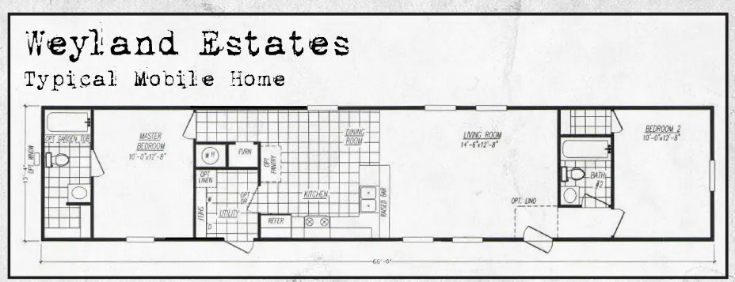
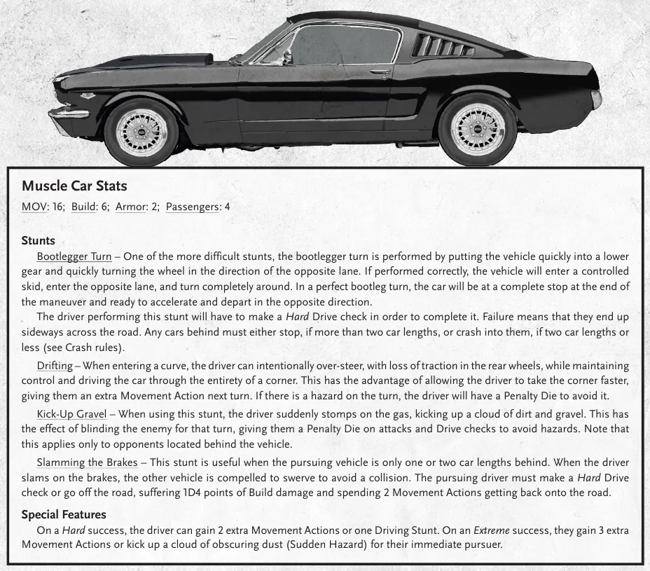

## Раздатка 5

> **Раздатка 5: типовой передвижной дом «Уэйленд-Эстейтс»**
>
> **«Уэйленд-Эстейтс». Типовой передвижной дом**
>
> *Подписи на плане:* главная спальня; санузел (садовая ванна — по выбору); стиральная машина/сушилка; чулан для белья (по выбору); кладовая; кухня; подсобка; обеденная зона; барная стойка; гостиная; линолеум (по выбору); вторая спальня; санузел 2. Длина дома — 66 футов (22 м).

<!-- -->

## Раздатка 6

> **Раздатка 6: маслкар**
>
> **Характеристики маслкара**
>
> Скорость 16; Комплекция 6; броня 2; пассажиров 4
>
> **Трюки**
>
> *Полицейский разворот* — один из самых трудных трюков: резко включить пониженную передачу и быстро повернуть руль в сторону встречной полосы. Если всё сделано верно, машина входит в управляемый занос, выезжает на встречную и полностью разворачивается; при идеальном развороте она в конце манёвра стоит на месте, готовая разогнаться в обратную сторону.
>
> Водитель делает трудную проверку Вождения. Провал — машина встаёт поперёк дороги. Идущие позади машины должны либо остановиться (если они дальше двух корпусов), либо врезаются в неё (если ближе; см. правила аварий).
>
> *Дрифт* — входя в поворот, водитель намеренно перекручивает руль с потерей сцепления задних колёс, сохраняя управление, и проходит поворот целиком. Так поворот проходится быстрее — лишнее действие перемещения в следующем ходу. Если на повороте опасность, водитель избегает её со штрафной костью.
>
> *Гравийный шлейф* — водитель резко жмёт на газ, поднимая облако пыли и гравия. Противник на этот ход ослеплён: штрафная кость на атаки и на проверки Вождения, чтобы избежать опасностей. Действует только на противников позади машины.
>
> *Резкое торможение* — полезно, когда преследователь лишь в одном-двух корпусах позади. Когда водитель бьёт по тормозам, преследователь вынужден вильнуть, чтобы избежать столкновения: его водитель делает трудную проверку Вождения, иначе вылетает с дороги, получая 1d4 урона Комплекции и тратя 2 действия перемещения, чтобы вернуться на дорогу.
>
> **Особенности**
>
> При трудном успехе водитель получает 2 лишних действия перемещения или один трюк; при чрезвычайном — 3 лишних действия перемещения или поднимает облако пыли (случайная опасность) для ближайшего преследователя.
