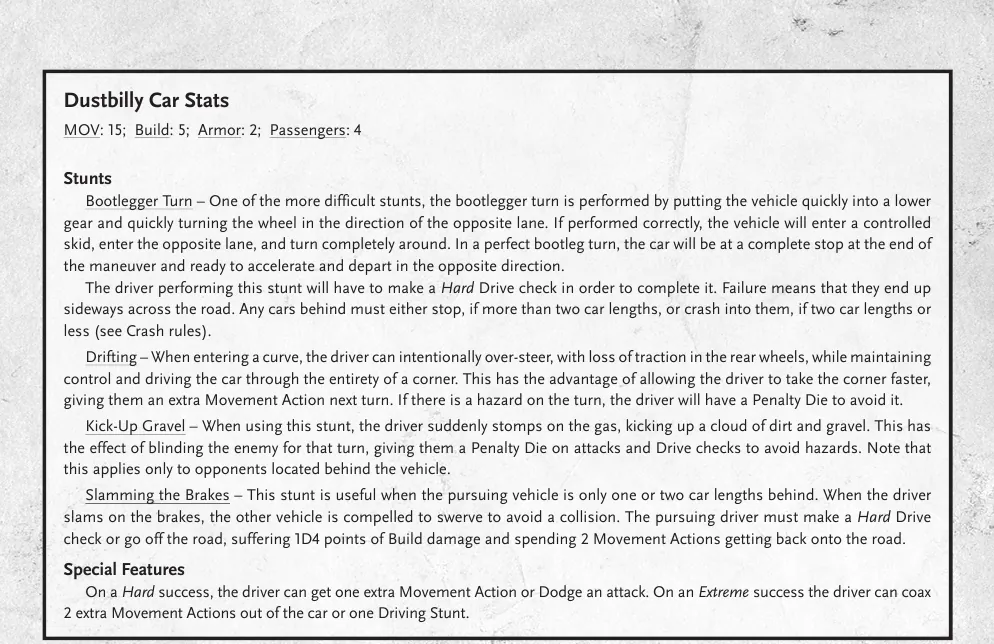
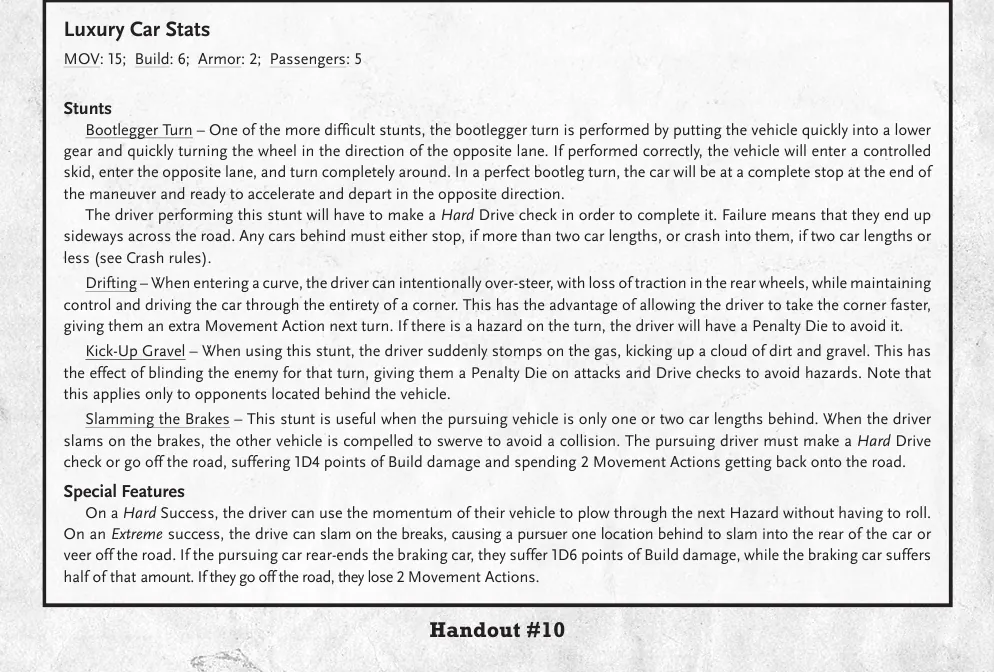

## Раздатка 9

> **Раздатка 9: машина дастбилли**
>
> **Характеристики машины дастбилли**
>
> Скорость 15; Комплекция 5; броня 2; пассажиров 4
>
> **Трюки**
>
> *Полицейский разворот* — один из самых трудных трюков: резко включить пониженную передачу и быстро повернуть руль в сторону встречной полосы. Если всё сделано верно, машина входит в управляемый занос, выезжает на встречную и полностью разворачивается; при идеальном развороте она в конце манёвра стоит на месте, готовая разогнаться в обратную сторону.
>
> Водитель делает трудную проверку Вождения. Провал — машина встаёт поперёк дороги. Идущие позади машины должны либо остановиться (если они дальше двух корпусов), либо врезаются в неё (если ближе; см. правила аварий).
>
> *Дрифт* — входя в поворот, водитель намеренно перекручивает руль с потерей сцепления задних колёс, сохраняя управление, и проходит поворот целиком. Так поворот проходится быстрее — лишнее действие перемещения в следующем ходу. Если на повороте помеха, водитель избегает её со штрафной костью.
>
> *Гравийный шлейф* — водитель резко жмёт на газ, поднимая облако пыли и гравия. Противник на этот ход ослеплён: штрафная кость на атаки и на проверки Вождения, чтобы избежать помех. Действует только на противников позади машины.
>
> *Резкое торможение* — полезно, когда преследователь лишь в одном-двух корпусах позади. Когда водитель бьёт по тормозам, преследователь вынужден вильнуть, чтобы избежать столкновения: его водитель делает трудную проверку Вождения, иначе вылетает с дороги, получая 1d4 урона Комплекции и тратя 2 действия перемещения, чтобы вернуться на дорогу.
>
> **Особенности**
>
> При трудном успехе водитель получает одно лишнее действие перемещения или уклоняется от атаки; при чрезвычайном — выжимает из машины 2 лишних действия перемещения или один трюк.

<!-- -->

## Раздатка 10

> **Раздатка 10: люксовый автомобиль**
>
> **Характеристики люксового автомобиля**
>
> Скорость 15; Комплекция 6; броня 2; пассажиров 5
>
> **Трюки**
>
> *Полицейский разворот* — один из самых трудных трюков: резко включить пониженную передачу и быстро повернуть руль в сторону встречной полосы. Если всё сделано верно, машина входит в управляемый занос, выезжает на встречную и полностью разворачивается; при идеальном развороте она в конце манёвра стоит на месте, готовая разогнаться в обратную сторону.
>
> Водитель делает трудную проверку Вождения. Провал — машина встаёт поперёк дороги. Идущие позади машины должны либо остановиться (если они дальше двух корпусов), либо врезаются в неё (если ближе; см. правила аварий).
>
> *Дрифт* — входя в поворот, водитель намеренно перекручивает руль с потерей сцепления задних колёс, сохраняя управление, и проходит поворот целиком. Так поворот проходится быстрее — лишнее действие перемещения в следующем ходу. Если на повороте помеха, водитель избегает её со штрафной костью.
>
> *Гравийный шлейф* — водитель резко жмёт на газ, поднимая облако пыли и гравия. Противник на этот ход ослеплён: штрафная кость на атаки и на проверки Вождения, чтобы избежать помех. Действует только на противников позади машины.
>
> *Резкое торможение* — полезно, когда преследователь лишь в одном-двух корпусах позади. Когда водитель бьёт по тормозам, преследователь вынужден вильнуть, чтобы избежать столкновения: его водитель делает трудную проверку Вождения, иначе вылетает с дороги, получая 1d4 урона Комплекции и тратя 2 действия перемещения, чтобы вернуться на дорогу.
>
> **Особенности**
>
> При трудном успехе водитель инерцией машины проламывается через следующую помеху без проверки. При чрезвычайном — резко тормозит, и преследователь, отстающий на одно место, врезается в зад машины или вылетает с дороги. Врезавшийся получает 1d6 урона Комплекции, тормозящий — половину; вылетевший теряет 2 действия перемещения.
