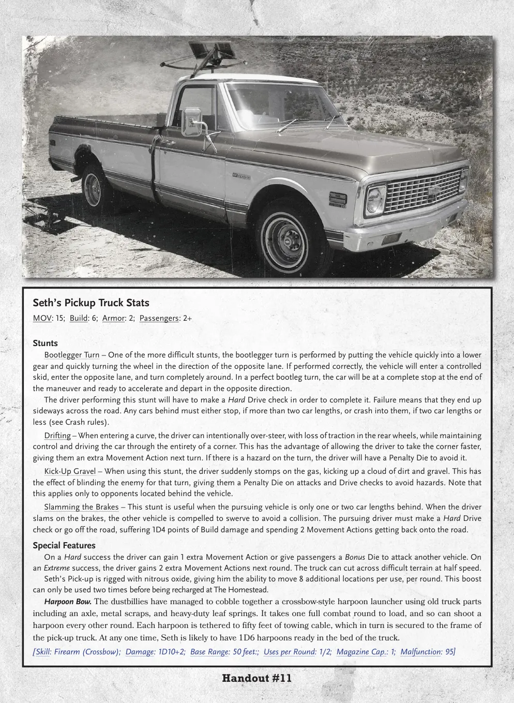

## Раздатка 11

> **Раздатка 11: пикап Сета**
>
> **Характеристики пикапа Сета**
>
> Скорость 15; Комплекция 6; броня 2; пассажиров 2+
>
> **Трюки**
>
> *Полицейский разворот* — один из самых трудных трюков: резко включить пониженную передачу и быстро повернуть руль в сторону встречной полосы. Если всё сделано верно, машина входит в управляемый занос, выезжает на встречную и полностью разворачивается; при идеальном развороте она в конце манёвра стоит на месте, готовая разогнаться в обратную сторону.
>
> Водитель делает трудную проверку Вождения. Провал — машина встаёт поперёк дороги. Идущие позади машины должны либо остановиться (если они дальше двух корпусов), либо врезаются в неё (если ближе; см. правила аварий).
>
> *Дрифт* — входя в поворот, водитель намеренно перекручивает руль с потерей сцепления задних колёс, сохраняя управление, и проходит поворот целиком. Так поворот проходится быстрее — лишнее действие перемещения в следующем ходу. Если на повороте опасность, водитель избегает её со штрафной костью.
>
> *Гравийный шлейф* — водитель резко жмёт на газ, поднимая облако пыли и гравия. Противник на этот ход ослеплён: штрафная кость на атаки и на проверки Вождения, чтобы избежать опасностей. Действует только на противников позади машины.
>
> *Резкое торможение* — полезно, когда преследователь лишь в одном-двух корпусах позади. Когда водитель бьёт по тормозам, преследователь вынужден вильнуть, чтобы избежать столкновения: его водитель делает трудную проверку Вождения, иначе вылетает с дороги, получая 1d4 урона Комплекции и тратя 2 действия перемещения, чтобы вернуться на дорогу.
>
> **Особенности**
>
> При трудном успехе водитель получает 1 лишнее действие перемещения или даёт пассажирам бонусную кость на атаку другой машины; при чрезвычайном — 2 лишних действия перемещения в следующем раунде. Пикап может срезать по труднопроходимой местности на половинной скорости.
>
> Пикап Сета снаряжён закисью азота: за применение он продвигается ещё на 8 мест (за раунд). Ускорение можно использовать лишь дважды, потом его перезаряжают в Усадьбе.
>
> Гарпунный самострел. Дастбилли собрали из старых деталей грузовика — оси, металлолома и мощных рессор — «арбалетную» пусковую установку для гарпунов. Заряжание занимает полный боевой раунд, так что стрелять гарпуном можно раз в два раунда. Каждый гарпун привязан к 15-метровому буксирному тросу, закреплённому на раме пикапа. Обычно у Сета наготове в кузове 1d6 гарпунов.
>
> [Навык: Стрельба (арбалет); урон 1d10+2; базовая дальность 15 м; выстрелов 1/2; ёмкость 1; осечка 95]

*Прим. перев.: так в оригинале — здесь и в описании гарпуна (с. 77) трос длиной 50 футов (15 м), а в правилах Охоты (с. 75) — 80 футов.*
