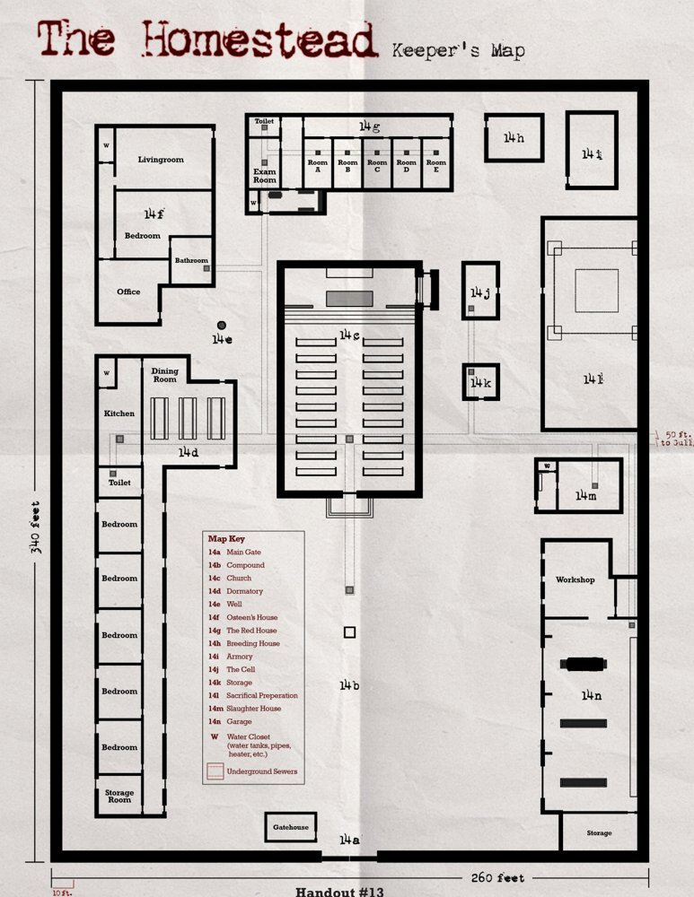

## Раздатка 13

*Карта Хранителя — та же, что на с. 42.*

**Усадьба. Карта Хранителя**

*Подписи комнат:* гостиная, спальня, ванная, кабинет (14f); туалет, смотровая, комнаты A–E (14g); столовая, кухня, туалет, спальни, кладовая (14d); мастерская и склад (14n); караульная у ворот (14a). Размеры стены: 340 футов (≈113 м) × 260 футов (≈87 м).

**Ключ карты**

| № | Место |
|---|---|
| 14a | Главные ворота |
| 14b | Двор (компаунд) |
| 14c | Церковь |
| 14d | Общежитие |
| 14e | Колодец |
| 14f | Дом Остина |
| 14g | Красный дом |
| 14h | Дом размножения |
| 14i | Арсенал |
| 14j | Камера |
| 14k | Склад |
| 14l | Подготовка жертв |
| 14m | Бойня |
| 14n | Гараж |
| W | Санузел (баки для воды, трубы, водонагреватель и т. п.) |
| — | Подземная канализация (пунктир) |

*Прим. перев.: в ключе карты опечатки оригинала — «Dormatory» (вместо Dormitory) и «Sacrifical Preperation» (вместо Sacrificial Preparation).*
