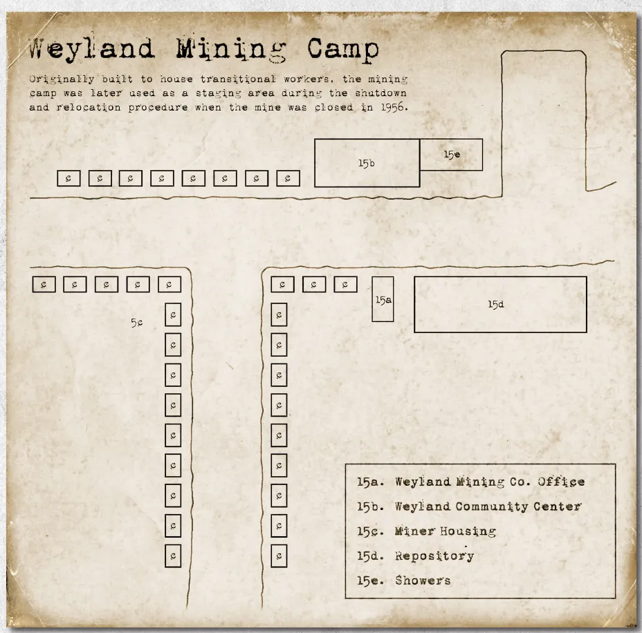

## Раздатка 14

> **Раздатка 14: схема шахтёрского посёлка**
>
> **Шахтёрский посёлок «Уэйленд»**
>
> Построенный для временных рабочих, посёлок позже служил перевалочной базой при остановке и переезде, когда шахту закрыли в 1956 году.
>
> - 15a. Контора горнодобывающей компании «Уэйленд»
> - 15b. Клуб «Уэйленд»
> - 15c. Дома шахтёров
> - 15d. «Репозиторий»
> - 15e. Душевые
