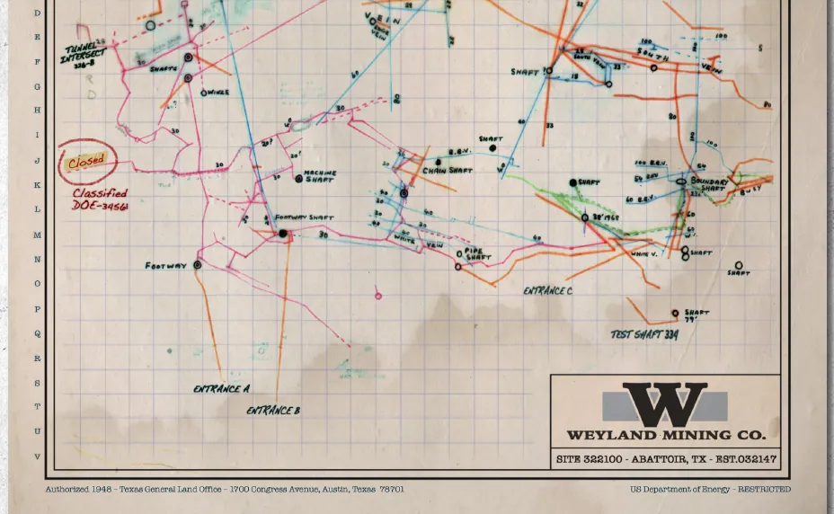

## Раздатка 15

> **Раздатка 15: карта шахт для игроков**
>
> **Карта игроков. Горнодобывающая компания «Уэйленд»**
>
> *Рукописная схема штолен на миллиметровке; большинство сокращений и пометок неразборчиво. Подписи: входы A, B, C; на одной штольне — обведённое красным «CLOSED» (закрыто) и «Classified DOE-34561» (секретно, Министерство энергетики, № 34561).*
>
> *Штамп:* Горнодобывающая компания «Уэйленд» — участок 322100 — Абаттуар, Техас — осн. 03.21.47.
>
> *Внизу листа:* «Утверждено в 1948 г. — Главное земельное управление Техаса — 1700 Конгресс-авеню, Остин, Техас 78701»; «Министерство энергетики США — ДОСТУП ОГРАНИЧЕН».
