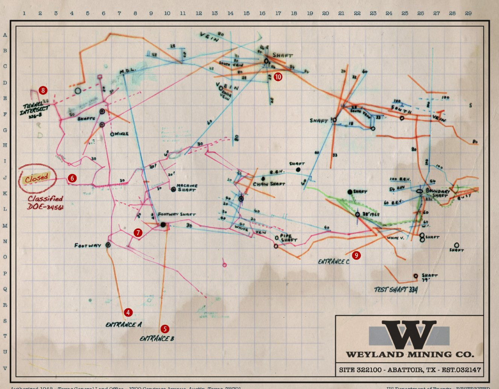

## Раздатка 16

**Карта Хранителя**

*Та же схема штолен, что в раздатке 15, с красными номерами мест 4–10:*

| № | Место |
|---|---|
| 4 | Старый вход в шахту (штольня A) |
| 5 | Новый вход в шахту (штольня B) |
| 6 | Закрытая штольня («Closed», «Classified DOE-34561») |
| 7 | Склад припасов в шахте |
| 8 | Пересечение туннелей |
| 9 | Второй вход в шахту (штольня C) |
| 10 | Последняя выработка |

*Рукописные подписи стволов и жил:* Machine Shaft — ствол для спуска оборудования; Chain Shaft — ствол для спуска снаряжения; Pipe Shaft — газоотводный ствол; Footway Shaft, Footway — ходовой ствол, ходок; Boundary Shaft — граничный ствол; Test Shaft — пробный ствол; Shaft — ствол; Winze — гезенк; Vein, South Vein, Edge Vein, White Vein — жила, Южная, Краевая, Белая жилы; M.D.L. и мелкие цифры глубин и уклонов — пометки маркшейдера. Цвета линий — см. ключ карты штолен (с. 59).

*Штамп и надписи внизу листа — как в раздатке 15.*
