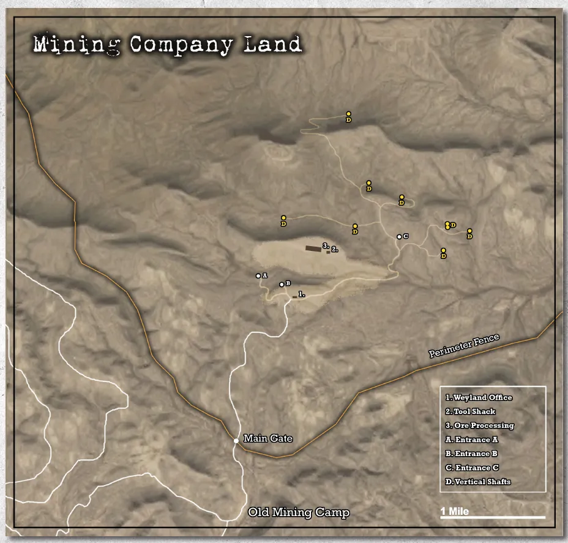

## Раздатка 17

> **Раздатка 17: земли горнодобывающей компании**
>
> **Земли горнодобывающей компании**
>
> 1. Контора «Уэйленд»
> 2. Инструментальная будка
> 3. Рудообогатительная фабрика
>
> - A. Вход A
> - B. Вход B
> - C. Вход C
> - D. Вертикальные стволы
>
> *Подписи на карте:* главные ворота; старый шахтёрский посёлок; ограда по периметру; масштаб — 1 миля (1,6 км).
