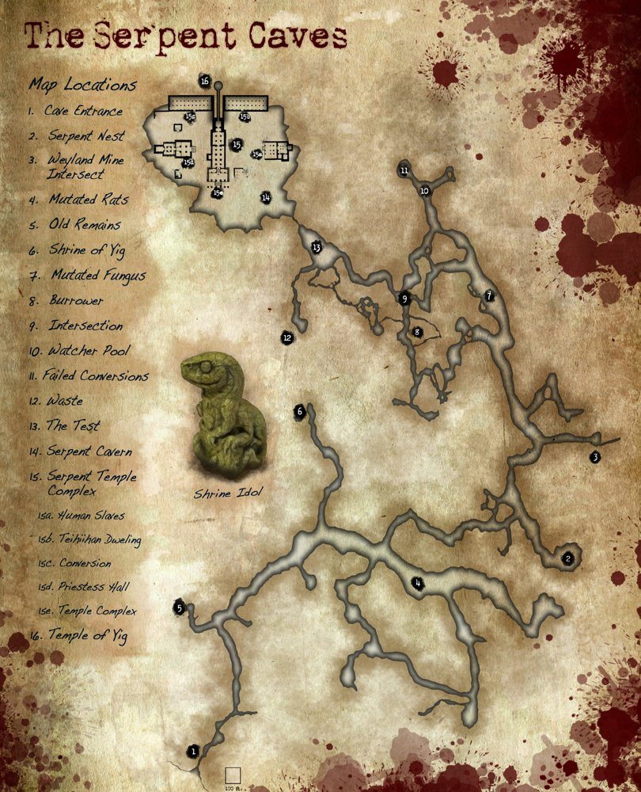

## Раздатка 18

*Карта Хранителя — та же, что на с. 69.*

**Змеиные пещеры**

**Места на карте**

| № | Место |
|---|---|
| 1 | Вход в пещеры |
| 2 | Змеиное гнездо |
| 3 | Пересечение с шахтой «Уэйленд» |
| 4 | Галерея крыс-мутантов |
| 5 | Старые останки |
| 6 | Святилище Йига |
| 7 | Грибной собор |
| 8 | Норы хтонийцев |
| 9 | Перекрёсток |
| 10 | Пруд наблюдателей |
| 11 | Неудавшиеся обращения |
| 12 | Сток нечистот |
| 13 | Испытание |
| 14 | Змеиная пещера |
| 15 | Комплекс Змеиного храма |
| 15a | Зал рабов |
| 15b | Жилище тейхиихан |
| 15c | Зал обращения |
| 15d | Зал жрицы |
| 15e | Храмовый комплекс |
| 16 | Храм Йига |

*Подпись к фото:* идол святилища.

*Прим. перев.: в ключе карты места 15a и 15c названы «Human Slaves» (рабы-люди) и «Conversion» (обращение); в тексте сценария — «Hall of Slaves» и «Conversion Hall».*
