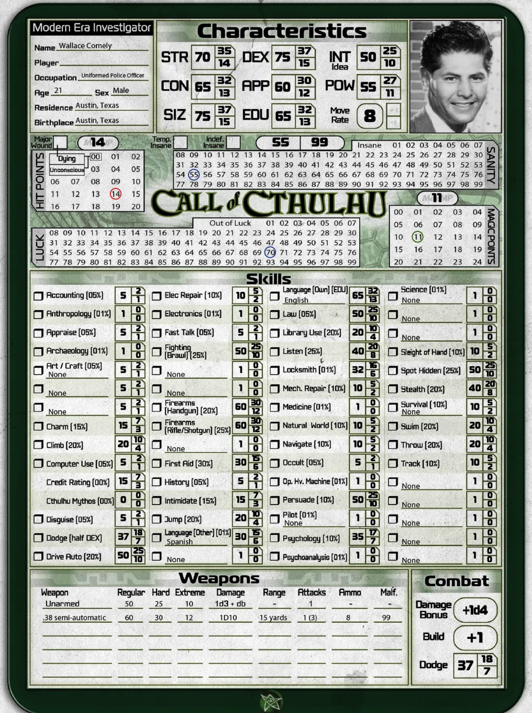

## Уоллес Комли

*Лист готового сыщика — Вариант 1: Тупик.*



```stat
Уоллес Комли — сыщик современной эпохи
Род занятий: патрульный полицейский
Возраст: 21    Пол: мужской
Место жительства: Остин, Техас    Место рождения: Остин, Техас

СИЛ 70 (35/14)      ЛВК 75 (37/15)      ИНТ 50 (25/10)
ВЫН 65 (32/13)      НАР 60 (30/12)      МОЩ 55 (27/11)
ТЕЛ 75 (37/15)      ОБР 65 (32/13)      СКО 8

ПЗ 14    Рассудок 55 (максимум 99)    Удача 70    ПМ 11

Навыки (выше базовых): Средства 15% (7/3), Вождение автомобиля 50% (25/10), Ближний бой (драка) 50% (25/10), Стрельба (пистолет) 60% (30/12), Стрельба (винтовка/дробовик) 60% (30/12), Иностранный язык (испанский) 30% (15/6), Родной язык (английский) 65% (32/13), Юриспруденция 50% (25/10), Слух 40% (20/8), Взлом 32% (16/6), Убеждение 50% (25/10), Психология 35% (17/7), Внимание 50% (25/10), Скрытность 40% (20/8)

Оружие (обычный / трудный / чрезвычайный успех):
  Без оружия — 50/25/10, урон 1d3+БкУ
  Полуавтоматический пистолет .38 — 60/30/12, урон 1d10; дальность 15 м, выстрелов 1 (3), магазин 8, осечка 99

Бой: БкУ +1d4; Комплекция 1; Уклонение 37 (18/7)
```
