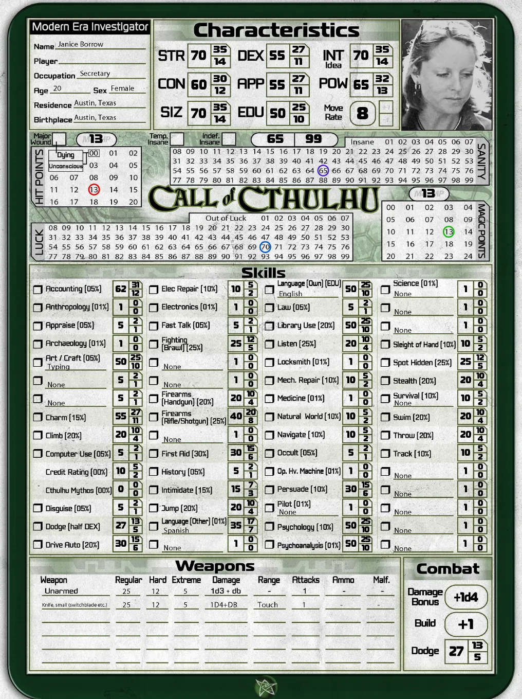

## Дженис Борроу

*Лист готового сыщика — Вариант 1: Тупик.*



```stat
Дженис Борроу — сыщик современной эпохи
Род занятий: секретарь
Возраст: 20    Пол: женский
Место жительства: Остин, Техас    Место рождения: Остин, Техас

СИЛ 70 (35/14)      ЛВК 55 (27/11)      ИНТ 70 (35/14)
ВЫН 60 (30/12)      НАР 55 (27/11)      МОЩ 65 (32/13)
ТЕЛ 70 (35/14)      ОБР 50 (25/10)      СКО 8

ПЗ 13    Рассудок 65 (максимум 99)    Удача 70    ПМ 13

Навыки (выше базовых): Бухгалтерия 62% (31/12), Искусство/ремесло (машинопись) 50% (25/10), Обаяние 55% (27/11), Средства 10% (5/2), Вождение автомобиля 30% (15/6), Стрельба (винтовка/дробовик) 40% (20/8), Иностранный язык (испанский) 35% (17/7), Родной язык (английский) 50% (25/10), Работа в библиотеке 50% (25/10), Убеждение 30% (15/6), Психология 50% (25/10), Психоанализ 50% (25/10)

Оружие (обычный / трудный / чрезвычайный успех):
  Без оружия — 25/12/5, урон 1d3+БкУ
  Нож малый (выкидной и т. п.) — 25/12/5, урон 1d4+БкУ; касание, 1 атака

Бой: БкУ +1d4; Комплекция 1; Уклонение 27 (13/5)
```
