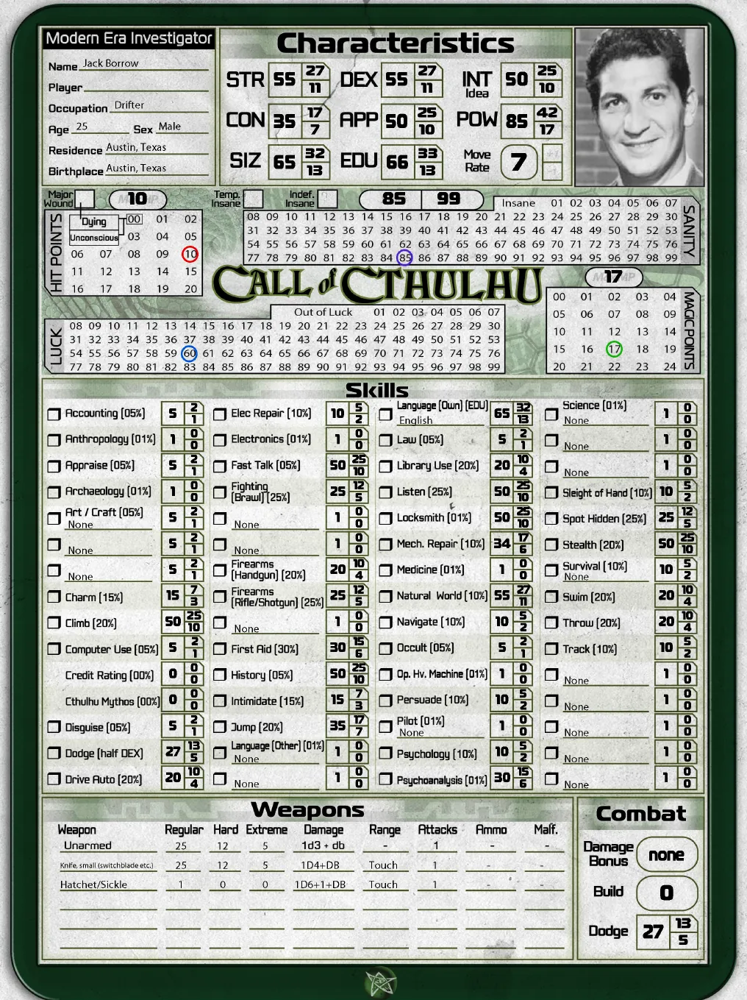

## Джек Борроу

*Лист готового сыщика — Вариант 1: Тупик.*



```stat
Джек Борроу — сыщик современной эпохи
Род занятий: бродяга
Возраст: 25    Пол: мужской
Место жительства: Остин, Техас    Место рождения: Остин, Техас

СИЛ 55 (27/11)      ЛВК 55 (27/11)      ИНТ 50 (25/10)
ВЫН 35 (17/7)       НАР 50 (25/10)      МОЩ 85 (42/17)
ТЕЛ 65 (32/13)      ОБР 66 (33/13)      СКО 7

ПЗ 10    Рассудок 85 (максимум 99)    Удача 60    ПМ 17

Навыки (выше базовых): Лазание 50% (25/10), Красноречие 50% (25/10), История 50% (25/10), Прыжки 35% (17/7), Родной язык (английский) 65% (32/13), Слух 50% (25/10), Взлом 50% (25/10), Механика 34% (17/6), Естествознание 55% (27/11), Психоанализ 30% (15/6), Скрытность 50% (25/10)

Оружие (обычный / трудный / чрезвычайный успех):
  Без оружия — 25/12/5, урон 1d3+БкУ
  Нож малый (выкидной и т. п.) — 25/12/5, урон 1d4+БкУ; касание, 1 атака
  Топорик/серп — 1/0/0, урон 1d6+1+БкУ; касание, 1 атака

Бой: БкУ none; Комплекция 0; Уклонение 27 (13/5)
```
