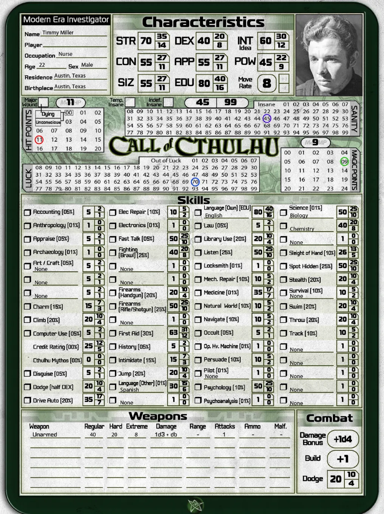

## Тимоти «Тимми» Миллер

*Лист готового сыщика — Вариант 1: Тупик.*



```stat
Тимми Миллер — сыщик современной эпохи
Род занятий: медбрат
Возраст: 22    Пол: мужской
Место жительства: Остин, Техас    Место рождения: Остин, Техас

СИЛ 70 (35/14)      ЛВК 40 (20/8)       ИНТ 60 (30/12)
ВЫН 55 (27/11)      НАР 55 (27/11)      МОЩ 45 (22/9)
ТЕЛ 55 (27/11)      ОБР 80 (40/16)      СКО 8

ПЗ 11    Рассудок 45 (максимум 99)    Удача 70    ПМ 9

Навыки (выше базовых): Средства 25% (12/5), Вождение автомобиля 35% (17/7), Красноречие 50% (25/10), Ближний бой (драка) 40% (20/8), Стрельба (винтовка/дробовик) 50% (25/10), Первая помощь 63% (31/12), Иностранный язык (испанский) 30% (15/6), Родной язык (английский) 80% (40/16), Слух 50% (25/10), Медицина 35% (17/7), Психология 50% (25/10), Наука (биология) 50% (25/10), Наука (химия) 40% (20/8), Ловкость рук 26% (13/5), Внимание 50% (25/10)

Оружие (обычный / трудный / чрезвычайный успех):
  Без оружия — 40/20/8, урон 1d3+БкУ

Бой: БкУ +1d4; Комплекция 1; Уклонение 20 (10/4)
```
