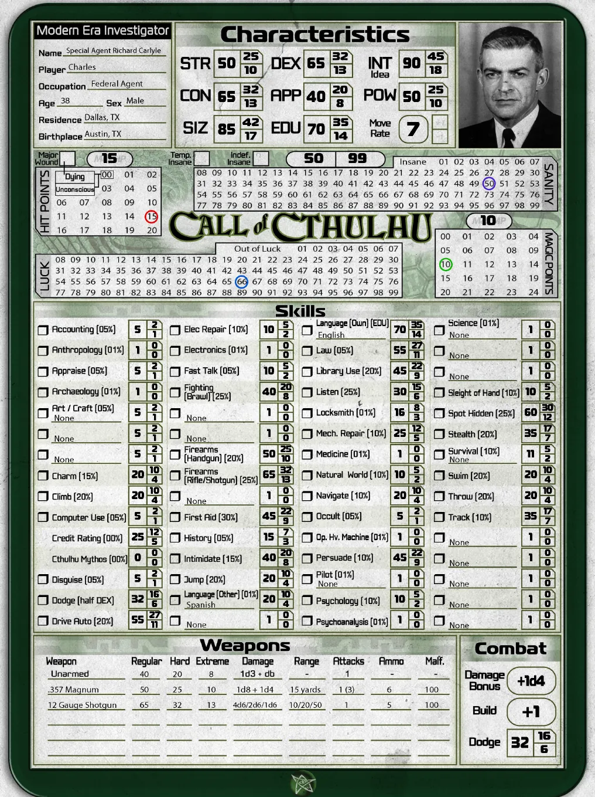

## Специальный агент Ричард Карлайл

*Лист готового сыщика — Вариант 2: Два детектива.*



```stat
Ричард Карлайл — сыщик современной эпохи
Род занятий: федеральный агент (ФБР)
Возраст: 38    Пол: мужской
Место жительства: Даллас, Техас    Место рождения: Остин, Техас

СИЛ 50 (25/10)      ЛВК 65 (32/13)      ИНТ 90 (45/18)
ВЫН 65 (32/13)      НАР 40 (20/8)       МОЩ 50 (25/10)
ТЕЛ 85 (42/17)      ОБР 70 (35/14)      СКО 7

ПЗ 15    Рассудок 50 (максимум 99)    Удача 66    ПМ 10

Навыки (выше базовых): Обаяние 20% (10/4), Средства 25% (12/5), Вождение автомобиля 55% (27/11), Красноречие 10% (5/2), Ближний бой (драка) 40% (20/8), Стрельба (пистолет) 50% (25/10), Стрельба (винтовка/дробовик) 65% (32/13), Первая помощь 45% (22/9), История 15% (7/3), Запугивание 40% (20/8), Иностранный язык (испанский) 20% (10/4), Родной язык (английский) 70% (35/14), Юриспруденция 55% (27/11), Работа в библиотеке 45% (22/9), Слух 30% (15/6), Взлом 16% (8/3), Механика 25% (12/5), Ориентирование 20% (10/4), Убеждение 45% (22/9), Внимание 60% (30/12), Скрытность 35% (17/7), Выживание 11% (5/2), Чтение следов 35% (17/7)

Оружие (обычный / трудный / чрезвычайный успех):
  Без оружия — 40/20/8, урон 1d3+БкУ
  Револьвер .357 «Магнум» — 50/25/10, урон 1d8+1d4; дальность 15 м, выстрелов 1 (3), барабан 6, осечка 100
  Дробовик 12-го калибра — 65/32/13, урон 4d6/2d6/1d6; дальность 10/20/50 м, выстрелов 1, магазин 5, осечка 100

Бой: БкУ +1d4; Комплекция 1; Уклонение 32 (16/6)
```
