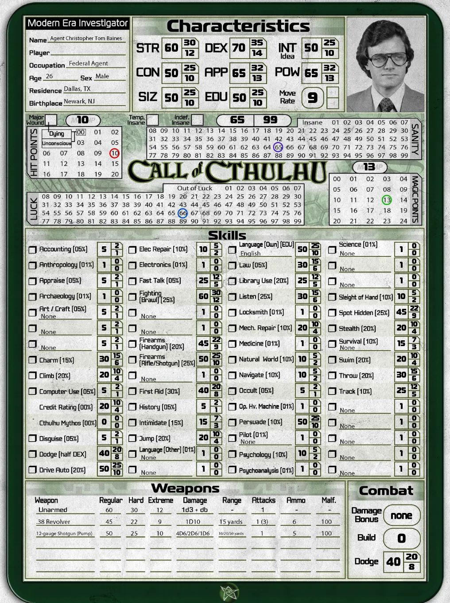

## Агент Кристофер Т. Бейнс

*Лист готового сыщика — Вариант 2: Два детектива.*



```stat
Кристофер Т. Бейнс — сыщик современной эпохи
Род занятий: федеральный агент (ФБР)
Возраст: 26    Пол: мужской
Место жительства: Даллас, Техас    Место рождения: Ньюарк, Нью-Джерси

СИЛ 60 (30/12)      ЛВК 70 (35/14)      ИНТ 50 (25/10)
ВЫН 50 (25/10)      НАР 65 (32/13)      МОЩ 65 (32/13)
ТЕЛ 50 (25/10)      ОБР 50 (25/10)      СКО 9

ПЗ 10    Рассудок 65 (максимум 99)    Удача 66    ПМ 13

Навыки (выше базовых): Обаяние 30% (15/6), Средства 20% (10/4), Вождение автомобиля 50% (25/10), Красноречие 25% (12/5), Ближний бой (драка) 60% (30/12), Стрельба (пистолет) 45% (22/9), Стрельба (винтовка/дробовик) 50% (25/10), Первая помощь 40% (20/8), Родной язык (английский) 50% (25/10), Юриспруденция 30% (15/6), Работа в библиотеке 25% (12/5), Слух 30% (15/6), Механика 20% (10/4), Убеждение 50% (25/10), Внимание 45% (22/9), Выживание 15% (7/3), Метание 30% (15/6), Чтение следов 25% (12/5)

Оружие (обычный / трудный / чрезвычайный успех):
  Без оружия — 60/30/12, урон 1d3+БкУ
  Револьвер .38 — 45/22/9, урон 1d10; дальность 15 м, выстрелов 1 (3), барабан 6, осечка 100
  Помповый дробовик 12-го калибра — 50/25/10, урон 4d6/2d6/1d6; дальность 10/20/50 м, выстрелов 1, магазин 5, осечка 100

Бой: БкУ none; Комплекция 0; Уклонение 40 (20/8)
```
