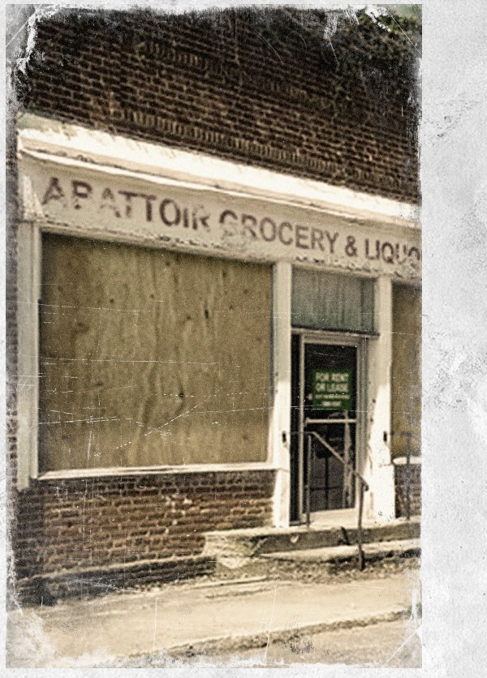

| Сленг | Значение |
|---|---|
| Off the hook | очень круто |
| Out of sight | очень круто |
| Peace out, home fry | пока, бывай |
| Radical | клёвый |
| Right on | согласиться с кем-то или чем-то; верно! |
| Rip off | хуже, чем ожидалось; надувательство |
| Say, brotha | привет, брат, как жизнь? |
| Shaggin’ wagon | фургон тех лет, переделанный, с кроватью в кузове |
| Sit on it | заткнись |
| Stone fox | сногсшибательная красотка |
| Ten-four, good buddy | понял тебя, дружище (жаргон радиосвязи CB) |
| The Man | любая власть: начальство, корпорация, полиция или правительство |
| Threads | шмотки, одежда |
| To go bananas | рехнуться |
| To the max | на полную, до упора |
| Tripping | чокнутый |
| What it is | как оно? что нового? |
| What’s your 20? | где ты? (жаргон радиосвязи CB) |
| Youngblood | молодой человек; парнишка |
| Zipperhead | коротко стриженный парень |

### Рекомендуемые грайндхаус-фильмы

Этот список фильмов призван вдохновить Хранителя и (или) игроков, которые собираются играть в этот сценарий. Не все эти фильмы происходят в том же времени или в тех же краях, но каждый воплощает дух жанра грайндхаус.

Учтите, что смотреть их, чтобы получить удовольствие от сценария, не обязательно, но если посмотреть их перед игрой, это почти наверняка поможет глубже погрузиться в историю.

- «Доказательство смерти» (Death Proof, 2007)
- «Грязная Мэри, сумасшедший Ларри» (Dirty Mary, Crazy Larry, 1974)
- «Дуэль» (Duel, 1971)
- «Дом 1000 трупов» (House of 1000 Corpses, 2003)
- «Я плюю на ваши могилы» (I Spit on Your Grave, 1978)
- «Последний дом слева» (Last House on the Left, 1972)
- «Гонка с дьяволом» (Race with the Devil, 1975)
- «Техасская резня бензопилой» (Texas Chainsaw Massacre, 1974)
- «У холмов есть глаза» (The Hills Have Eyes, 1977)
- «Исчезающая точка» (Vanishing Point, 1971)

### Наличные и имущество — 1975

| Средства | Наличные | Имущество | Уровень трат |
|---|---|---|---|
| Без гроша (Средства 0 и меньше) | $5 | нет | $5 |
| Бедный (Средства 1–9) | Средства × 10 ($10–$90) | Средства × 100 ($100–$900) | $20 |
| Средний (Средства 10–49) | Средства × 20 ($200–$980) | Средства × 500 ($5 тыс.–$24,5 тыс.) | $100 |
| Состоятельный (Средства 50–89) | Средства × 50 ($2,5 тыс.–$4,45 тыс.) | Средства × 5000 ($250 тыс.–$445 тыс.) | $500 |
| Богатый (Средства 90–98) | Средства × 200 ($18 тыс.–$19,6 тыс.) | Средства × 20 000 ($1,8 млн–$1,96 млн) | $2500 |
| Сверхбогатый (Средства 99) | $500 000 | 50 млн и больше | $50 000 |

*Общее правило: если сегодня что-то стоит $10, в 1975 году это стоило около $2.*
