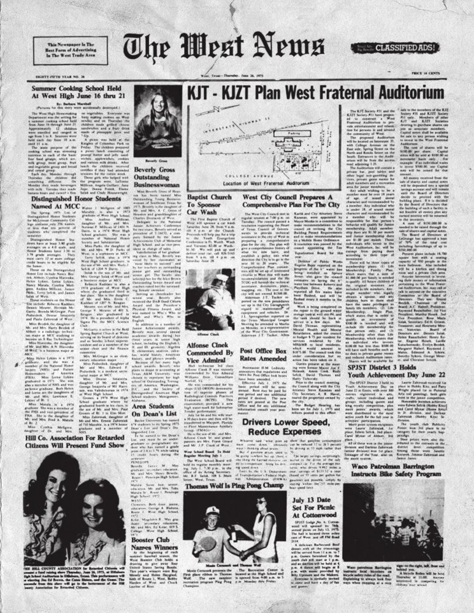

*Полностраничная атмосферная иллюстрация: первая полоса настоящей местной газеты «The West News» (Уэст, Техас, четверг, 26 июня 1975 года) — за несколько недель до событий сценария. Заметки газеты к сюжету не относятся; перевод шапки и заголовков:*

- *Шапка:* «Уэст ньюс»; «Эта газета — лучший способ дать рекламу в торговой округе Уэста»; «Маленькие объявления — большие результаты. Частные объявления!»; «Восемьдесят пятый год издания, № 26»; «Цена 10 центов»
- В Уэстской средней школе 16–21 июня прошла летняя кулинарная школа
- Названы отличники Общественного колледжа Макленнана (MCC)
- Ассоциация помощи умственно отсталым округа Хилл проведёт благотворительный концерт
- Общества KJT и KJZT собираются построить Братский зал Уэста (на плане — «Расположение Братского зала Уэста»)
- Беверли Гросс — выдающаяся деловая женщина
- Баптистская церковь устраивает благотворительную мойку машин
- Городской совет Уэста готовит комплексный план развития города
- Альфонса Синека отметил вице-адмирал
- Изменены тарифы на почтовые ящики
- Школьный совет Уэста проведёт очередное заседание 7 июля
- Местные студенты — в списке декана
- Водители сбавляют скорость и сокращают расходы
- Томас Вулф — чемпион по пинг-понгу
- Клуб болельщиков назвал победителей
- Пикник в Коттонвуде назначен на 13 июля
- Округ 3 SPJST 22 июня проводит День достижений молодёжи
- Патрульный из Уэйко Баррингтон проводит занятия по безопасной езде на велосипеде
