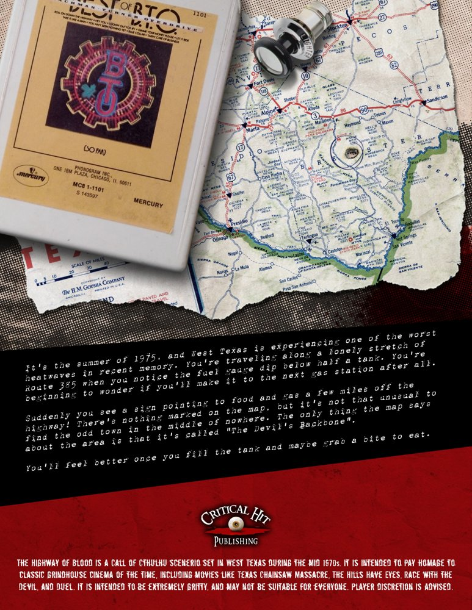

## Задняя обложка

> *Лето 1975 года, и Западный Техас переживает одну из самых страшных жар на памяти людей. Вы едете по пустынному участку шоссе 385 и вдруг замечаете, что стрелка указателя топлива опустилась ниже половины бака. Вы уже начинаете сомневаться, дотянете ли до следующей заправки.*
>
> *Вдруг вы видите указатель: еда и бензин в нескольких километрах от шоссе! На карте там ничего не отмечено, но в глуши такие городки — не редкость. Единственное, что сказано на карте об этих местах, — что они называются «Хребет Дьявола».*
>
> *Вам станет легче, когда заправите бак и, может быть, перекусите.*

**Critical Hit Publishing**

«Шоссе крови» — сценарий для «Зова Ктулху», действие которого происходит в Западном Техасе в середине 1970-х. Он задуман как дань классическому кино грайндхаус того времени — таким фильмам, как «Техасская резня бензопилой», «У холмов есть глаза», «Гонка с дьяволом» и «Дуэль». Сценарий задуман предельно жёстким и может подойти не всем. Игрокам рекомендуется осмотрительность.
