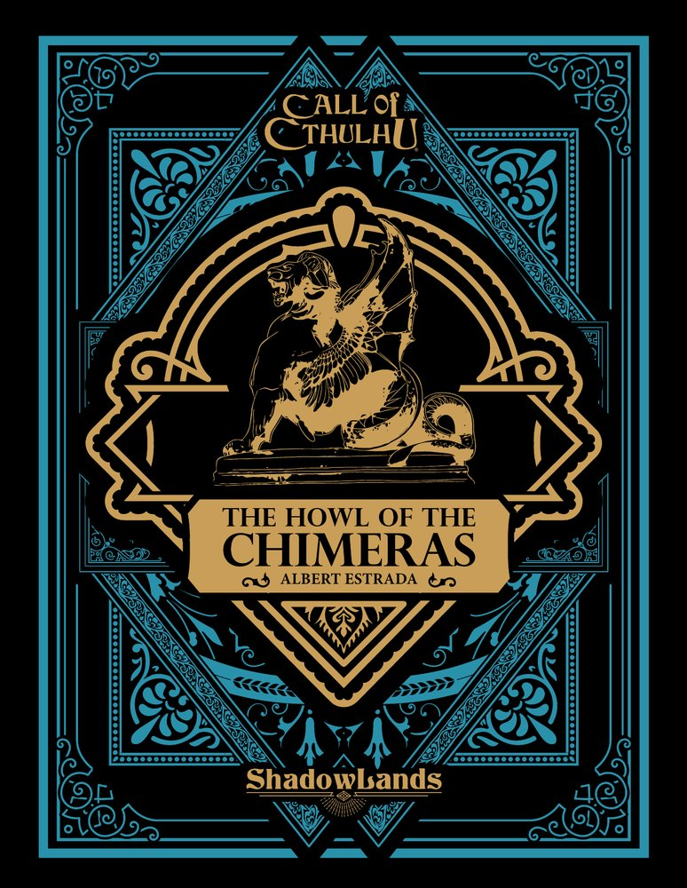

ВОЙ ХИМЕР

Альберт Эстрада Самбрано

*На обложке — золотая химера на чёрно-бирюзовом орнаментальном фоне; вверху — логотип «Call of Cthulhu», в центре — название «The Howl of the Chimeras» и имя автора (Albert Estrada), внизу — логотип Shadowlands.*
