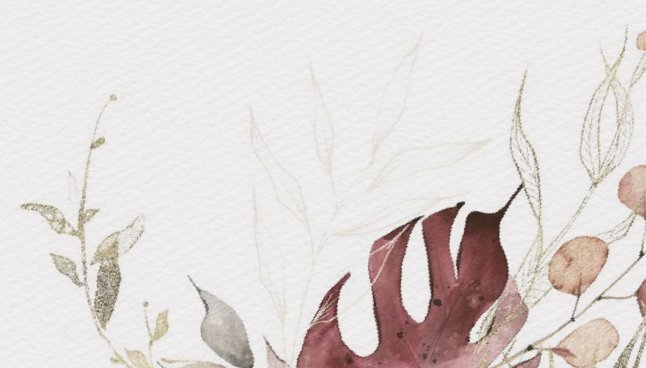

| Раздел | Стр. |
|---|---|
| Подготовка сцены | 162 |
| Сторона противника | 162 |
| Переговоры | 162 |
| Сделка | 163 |
| Решение | 163 |
| Новое пробуждение | 166 |
| **Персонажи Хранителя** | 167 |
| Лорд Амадеус Дьюар | 168 |
| Леди Эдна (Фелтон) Дьюар | 169 |
| Мистер Элдон Дав | 170 |
| Орфей | 170 |
| Миссис Ленора Реддинг | 171 |
| Мисс (Мэри) Элизабет Милфорд | 171 |
| Мистер Хорас О’Коннелл и его бригада | 172 |
| Мистер Гаррет Уилтон | 173 |
| Мистер Хэнк Шерман | 174 |
| Миссис Пэтси Шерман | 174 |
| Эстер, Амелия и Флора Шерман | 175 |
| Селина Бейнбридж | 176 |
| Мистер Джулиус Коллингвуд | 176 |
| Миссис Генриетта (Этти) Юнис | 177 |
| Виктор Бердетт | 178 |
| Ральф Лаверик | 178 |
| Питер Хелм | 179 |
| Инспектор Барнабас (Барни) Гонтлетт и его люди | 179 |
| Браконьеры | 180 |
| **Темы разговора** | 181 |
| Лорд Амадеус Дьюар | 182 |
| Сиделка Ленора Реддинг | 186 |
| Горничная мисс (Мэри) Элизабет Милфорд | 186 |
| Конюх Гаррет Уилтон | 186 |
| Хэнк и Пэтси Шерман | 186 |
| Сладострастные Эстер, Амелия и Флора Шерман | 186 |
| Мистер Хорас О’Коннелл и его бригада | 187 |
| Художник Джулиус Коллингвуд | 191 |
| Ясновидящая Генриетта (Этти) Юнис | 191 |
| Маленький Виктор Бердетт | 193 |
| Рыбак Питер Хелм | 193 |
| **Сыщики** | 198 |
| Мистер Артур Уилтшир | 198 |
| Мисс Глэдис Косгроув | 200 |
| Сэр Джаспер Брамли | 202 |
| **Раздатки** | 205 |
| Раздатка 1. Планы внутренних помещений особняка | 206 |
| Раздатка 2. Карта земель вокруг особняка | 210 |
| Раздатка 3. Плакат «Разыскиваются» | 211 |
| Раздатка 4. Листовка мюзик-холла | 212 |
| Раздатка 5. Предсмертная записка | 213 |
| Раздатка 6. Заметки доктора | 214 |
| Раздатка 7. Чертёж чана | 215 |
| Раздатка 8. Отрывок из «Метаморфоз» Овидия | 216 |
| Раздатка 9. Сокровище Льянганатес | 217 |
| Раздатка 10. Книга об оккультизме | 218 |

*Номера страниц — по оригиналу; в этом файле они отмечены внизу каждой страницы («с. N оригинала»).*

