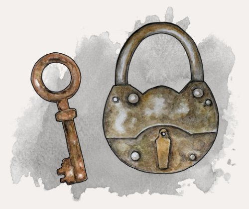

> *(Врезка «Правда», продолжение.)*
>
> Лорд Дьюар не мог допустить, чтобы толпа суеверных слуг разносила о нём слухи по знатным домам Шотландии, поэтому приказал Даву убить их всех. В конце концов, кого обеспокоит исчезновение нескольких слуг?
>
> Покончив с этим, Дьюар начал свои опыты и основал санаторий в надежде привлечь людей, которые могли бы послужить его научным изысканиям. Наконец, когда он был готов приступить к заключительной фазе своего проекта, он с помощью двух доверенных сообщников придумал, как заманить людей, выбранных на замену его семье.
>
> Дав и Ленора Реддинг сперва нашли певичку кабаре Кэролайн Гейтс в захудалом театре в Ковент-Гардене. Через неё они устроили встречу с Уильямом Бедфордом, мелким воришкой и одним из её постоянных клиентов (его счастливый пенни на самом деле — жетон из борделя, где работает Кэролайн).
>
> Уильям и Кэролайн познакомились через Сэмюэла Гейтса, её брата и друга Генри Бедфорда, брата Уильяма. Генри Бедфорд и Сэмюэл Гейтс оба состояли в революционном, анархистском и преступном рабочем заговоре (металлический жетон, который носит Уильям, и правда был подарком Генри, получившего его от Сэмюэла в уплату долга).
>
> Так или иначе, выдав себя за недовольных слуг, которые «кое-что слышали», мистер Дав и миссис Реддинг в грязной таверне на берегу Темзы очаровали Уильяма Бедфорда историей о сокровище инков и исподволь подтолкнули его к затее его украсть — вместе с братом Генри и Кэролайн. Пробраться в поместье, разумеется, было легко, ведь лэрд и его люди их ждали. Их схватили, заперли в катакомбах — и там началось перепрограммирование: превращение их в трёх совершенно других людей — Джаспера, Артура и Глэдис.
>
> *Прим. перев.:* здесь «счастливый пенни» Уильяма назван жетоном из борделя, а «металлический жетон» — подарком Генри; по сцене «Джаспер Брамли: счастливая монета» (с. 160) это одна и та же монета.

