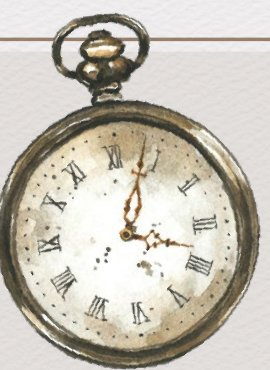

> Следуя тому же правилу чередования второго и третьего лица, представляя приключение группе, можно начать словами: «Вы — трое проходимцев, решивших украсть состояние у шотландского лорда», — обращаясь прямо к игрокам. Затем достаньте из папки листы персонажей, взгляните на них и продолжайте: «А теперь я представлю героев этой истории, и вы выберете, кем хотите стать. Первый — Артур Уилтшир, дилетант и политический активист, племянник лорда…» С этого момента и до конца представления говорите о персонажах в третьем лице.

стыковки, вы подрываете ту конечную цель, ради которой они введены: подсознательно предупредить игроков, что всё не так, как кажется.

Когда игроки задают такие вопросы, придумывайте разные отговорки, чтобы не отвечать. Можно просто сказать, что вы не знаете, потому что книга этого не проясняет, или что не помните. Если они продолжают настаивать, можно сказать, что их персонажи этого не помнят, — но в конечном счёте так ли важно, на шпагах была дуэль или на пистолетах? Можно и вернуть вопрос им: «А вы как думаете?» — сделав вид, что передаёте им контроль над повествованием.

Если же, несмотря ни на что, игроки настаивают на изучении какой-то детали — например, осматривают рану на руке Артура, — вам придётся без всякой двусмысленности пояснить, что рана нанесена клинком шпаги, даже если прежде вы согласились, что дуэль была на пистолетах. После игры вы можете напомнить игрокам обо всех этих моментах, и они получат удовольствие от прозрения, взглянув на них с высоты того, что теперь знают.

Несмотря на все ваши старания, игроки могут решить, что вы над ними издеваетесь, и упрямо пытаться выяснить, что происходит на самом деле, вместо того чтобы искать ответы внутри самой игры. Если дошло до несомненной, непоправимой потери доверия за столом, у вас всегда есть последнее отчаянное средство: покажите им врезку на следующей странице. Увидев написанное предсказание того, что они сейчас чувствуют, они, возможно, взглянут на всё иначе.

> **Уловка**
>
> Есть много способов обращаться с вопросами игроков. Например, если игрок, ведущий Артура, спрашивает: «Откуда у меня рана на руке?» — на удивление действенный ответ: «Тебя укусила змея». Если применить его в нужный момент, этот ответ может настолько сбить игроков с толку, что у них пропадёт желание расспрашивать дальше. Позже, во время финального противостояния приключения, можно вернуться к этому моменту, создав сильное ощущение предопределённости и поистине впечатляющую развязку.

Может случиться, что вы будете играть эту историю с группой, которая скорее позволит внешним событиям диктовать темп игры. Игроки могут не решаться проявить инициативу или слишком бояться бросить прямой вызов лорду Дьюару, опасаясь сорвать планы Хранителя. Из-за этого они могут застрять, не в силах сделать последний ход, нужный для завершения приключения, — и это приведёт к раздражению и бесконечно затянувшейся игре. Если вы думаете, что так может случиться, хорошо бы с самого начала (или даже во время игры, если нужно) заверить их, что у них полная свобода играть своих персонажей так, как они считают нужным. Призовите их отбросить всякий страх «испортить сюжет» поступками, которые кажутся верными для
