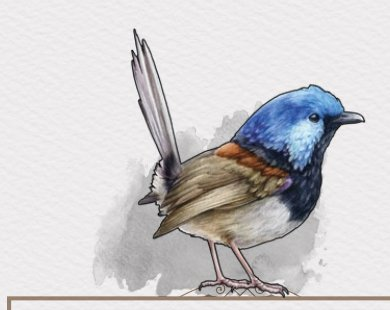

> **ДОРОГОЙ ИГРОК «ВОЯ ХИМЕР»!**
>
> ВО ВРЕМЯ ЭТОЙ ИГРЫ ТЕБЕ МОЖЕТ ПОКАЗАТЬСЯ, ЧТО ХРАНИТЕЛЬ ВОДИТ ТЕБЯ ЗА НОС, НАРОЧНО ИГНОРИРУЕТ ПРАВИЛА ИЛИ ЧТО НИ ПРИКЛЮЧЕНИЕ, НИ ТВОЙ ПЕРСОНАЖ НЕ ВПОЛНЕ ИМЕЮТ СМЫСЛ. ТАК МОЖЕТ ПОКАЗАТЬСЯ, НО УВЕРЯЮ ТЕБЯ: ЭТО НЕ ТАК.
>
> ПРИЗЫВАЮ ТЕБЯ ДОВЕРИТЬСЯ И МОДУЛЮ, И ТОМУ, КТО ЕГО ВЕДЁТ. ПОГРУЗИСЬ В ИСТОРИЮ С ОТКРЫТЫМ СЕРДЦЕМ И ПОСТАРАЙСЯ НАСЛАДИТЬСЯ ЭТИМ ОПЫТОМ СПОЛНА.
>
> КТО ЗНАЕТ? МОЖЕТ БЫТЬ, К КОНЦУ ТЫ ПОЙМЁШЬ, ЧТО ВСЁ ЭТО ИМЕЛО СМЫСЛ.

своих персонажей. Заверьте их, что сломать игру они не могут, и подтолкните их полностью в неё включиться.

Пока вы улаживаете эти предварительные вопросы, полезно также пояснить, что на самом деле значит ограбить лорда Дьюара и сколь велико нужное им богатство.

Замок Дьюар — не подземелье, которое надо разграбить. Ограбить лорда Дьюара — это не рассовать по карманам столовое серебро, прихватить пару подсвечников, салатницу, золотые часы или картину с площадки второго этажа. Это и близко не подведёт их к цели. Объясните, что когда вы описываете ожерелье, старинную книгу или предмет мебели как ценные, это лишь значит, что это не дешёвая безделушка: вещь дорогая и роскошная, но им по-настоящему не поможет. Заверьте их, что вы ясно дадите понять, когда им попадётся что-то действительно стоящее кражи, и предложите не обращать внимания на всё остальное: в конце концов, они люди состоятельные, а не мелкие воришки из доков. Чтобы выпутаться из передряги, им нужны настоящие деньги, а не мелочь на карманные расходы.

Ну, на самом деле они и есть голодные воришки — просто ещё этого не поняли.

## Как применять правила

Это приключение создавалось с расчётом на правила седьмой редакции «Зова Ктулху», хотя его нетрудно приспособить к более ранним редакциям и даже к другим игровым системам. В конце концов, суть этой истории — в сюжете, а не в механике бросков.

Тем не менее важно помнить о нескольких ключевых особенностях игровой механики модуля.

Необычное положение сыщиков плохо укладывается в стандартные правила Рассудка «Зова Ктулху». Ближайший аналог в официальной механике — бессрочное безумие в период затаённого безумия: оно позволяет искажать предыстории персонажей и даёт Хранителю вводить галлюцинации. Однако оно же вызывает приступы безумия даже при небольших потерях Рассудка, что не вполне подходит общему сценарию. В конце концов, сыщики в некотором смысле — пациенты лечебницы, только лечащий их доктор не заинтересован ни в том, чтобы их вылечить, ни в том, чтобы свести их с ума. Его цель — превратить их в совершенно других людей. Поэтому обычные правила бессрочного безумия здесь напрямую не применяются.

Проще всего применять правила Рассудка так, будто сыщики полностью в здравом уме. Так вы не выдадите игрокам, что происходит на самом деле. Разум их персонажей нездоров, но они об этом не знают.

Тем не менее, если игрок просит сделать проверку Рассудка, чтобы «осознать» какую-то искажающую восприятие иллюзию, разрешите её. В зависимости от результата лорд
