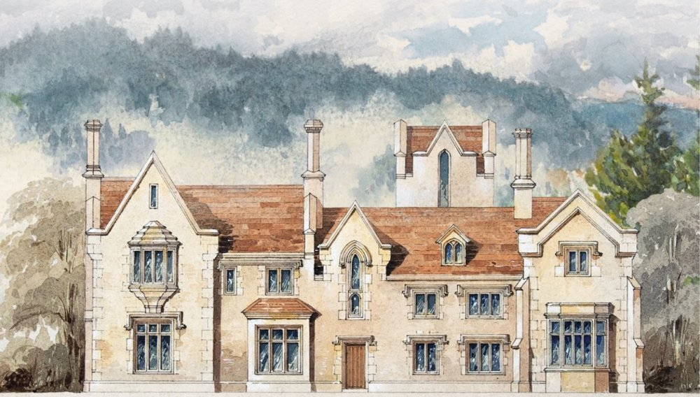

Дьюар или Дав могут это заметить и постараться быстро исправить положение, вернув сыщика в гипнотический транс. Удастся ли им это автоматически — например, благодаря обусловленности, заложенной в психику персонажа, — или сыщик будет сопротивляться и вынудит их прибегнуть к препаратам, решать вам.

Кроме того, проценты навыков на листах персонажей не точно отражают подлинные способности сыщиков — иногда они выше, иногда ниже.

Гипнотический процесс, которому подверглись сыщики, мешает им замечать эти расхождения. Их разум находит разумные объяснения тому, почему они толком не умеют ездить верхом, хотя делали это с детства, или почему у них, похоже, талант к вскрытию замков, хотя прежде они никогда этого не пробовали. Как Хранителю вам придётся давать объяснения, прикрывающие правду («Похоже, лошади лорда Дьюара особенно норовисты»), но позволяйте этим нестыковкам временами проглядывать — лишь затем, чтобы быстро прикрыть их снова, когда действия сыщиков их обнаружат.

Раз вы не будете сравнивать броски с процентами навыков на листах сыщиков, смело игнорируйте результаты и решайте, удалось действие или нет, исходя из нужд истории. Чтобы помочь вам в этом, подлинные проценты навыков в книгу не включены. Удалось ли Глэдис стащить письмо у Дава с результатом 58? Если это подходит истории — удалось. Если нет — значит, 58 не хватило.

Не стесняйтесь так поступать — это не нечестно. Помните, что большинство проверок, которые совершают сыщики, всё равно не настоящие проверки навыков. Всё, что происходит в лечебнице, — часть сложной иллюзии. Мисс Косгроув, вероятно, вскрывала этот замок уже много раз; её сознательное «я» этого не помнит, но мышечная память помнит, так что ей это легко — если только лорд Дьюар не заменил его новым, более надёжным замком, который ей не вскрыть. Дав, возможно, уже знает, что они попытаются украсть письмо, потому что так уже бывало, но он либо позволит этому случиться, либо помешает — в зависимости от того, что в этот момент нужно лорду Дьюару.

Кроме критических успехов, крахов и чрезвычайных успехов, когда результат костей слишком важен, чтобы его игнорировать, у вас достаточно простора для манёвра. Однако если Глэдис, прокрадываясь в комнату Дава, опрокинет фарфоровую вазу и та разобьётся, Даву ничего не останется, кроме как обернуться и поймать её, даже если это разрушит планы его хозяина.

Помните, что вы всегда можете дать бонусные или штрафные кости в зависимости от ситуации — и даже использовать это, чтобы ввести игроков в заблуждение насчёт их подлинных шансов на успех. Можно также попросить их бросать за ширмой.

