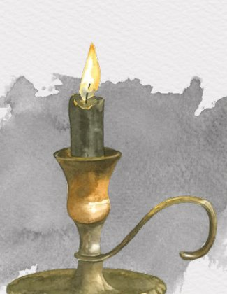

В седьмой редакции «Зова Ктулху» есть необязательное правило «Скрытый урон», которое мудро признаёт, что люди обычно не могут определить (по крайней мере с математической точностью), насколько тяжелы их раны и сколько пунктов здоровья у них осталось. Хранителю даже советуют требовать фальшивые проверки ВЫН, чтобы запутать игроков насчёт подлинной тяжести полученного урона.

Если эта логика применима к телесным ранам, то к пунктам Рассудка — тем более. В конце концов, о своих физических травмах человек ещё может иметь хоть какое-то представление, а вот точно оценить своё душевное здоровье куда труднее.

Мы и о том, насколько искусны в разных областях, редко знаем в точности. Вы, наверное, слышали об эффекте Даннинга — Крюгера: люди, некомпетентные в какой-то области, часто об этом не подозревают, потому что навыки, нужные для оценки своих способностей, — это именно те навыки, которых им недостаёт. Если игроки не уверены, сколько в точности пунктов здоровья у их сыщиков, то логично, что они не должны быть уверены и в точном проценте успеха любого из своих навыков.

