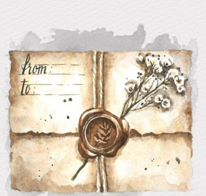

**Питер Хелм**  
44 года, хотя выглядит далеко за пятьдесят. Браконьер-краболов, который постоянно облизывает пальцы от крабового сока. Крайне недоверчив и сбежит, если увидит приближение незнакомцев. С первой же встречи его враждебность к лэрду должна быть очевидна, чтобы сыщики не стали представляться, — если же представятся, он отмахнётся от них как от самозванцев. Может рассказать о долгой браконьерской истории своей семьи, о злодеяниях, которые приписывают лорду Оуэну (говорили, что тот охотился на людей), о своей неверной жене и её любовнике (контрабандисте). Хелм считает, что на замке Дьюар лежит проклятие — то ли призрака лорда Оуэна, то ли сокровища инков, то ли укуса демонического существа, который получил лорд Амадеус. Он также предупредит о том, что в деревне объявился Скотленд-Ярд, об опасностях побережья (полного скрытых бухт) и о соблазнительных пастушках. Рабочий класс (нищий).

Их игровые характеристики — в главе «Персонажи Хранителя».

## Другие персонажи, упомянутые в истории

**Мистер Генри Бедфорд**  
Вор, который считает себя Артуром Уилтширом.

**Мистер Уильям Бедфорд**  
Вор, который считает себя Джаспером Брамли.

**Мисс Кэролайн Гейтс**  
Танцовщица кабаре и проститутка, которая считает себя Глэдис Косгроув.

**Лорд Оуэн Дьюар**  
Заслуженный военный, отец доктора Амадеуса Дьюара. Умер, когда Амадеусу было всего тринадцать.

**Капитан Колумбус Тведдл**  
Высокопоставленный военный и контрабандист, лучший друг и боевой товарищ лорда Оуэна Дьюара. Отец Фиделии Уилтшир. Умер.

**Миссис Фиделия (Тведдл) Уилтшир**  
Дочь леди Эдны Дьюар и Колумбуса Тведдла, рождённая после того, как леди Эдна овдовела; в браке они так и не состояли. Погибла при пожаре почти четыре года назад. Сегодня ей было бы 48 лет.

**Мистер Джонатан Уилтшир**  
Неудачливый торговец, искупивший себя перед смертью. Муж Фиделии и отец Артура. Погиб вместе с женой. Сегодня ему было бы 53 года.

**Мистер Сэмюэл Косгроув (на самом деле Сэмюэл Гейтс)**  
27 лет. Брат Глэдис Косгроув (на самом деле Кэролайн Гейтс); сейчас в тюрьме.

**Бьюфорд Глен, Лютер Эйвери, Перри Гилмор и Стивен Дикин**  
Вместе с Сэмюэлом Гейтсом — остальные члены «Дела», подрывной группы, в которой состоит Артур Уилтшир (хотя на самом деле в группе состоит Генри Бедфорд).

**Сэр Эдмунд Брамли**  
61 год. Отец Джаспера Брамли. Грубоватый вояка-шовинист и искатель приключений, ныне женатый на женщине одних лет со своим сыном.

**Эвридика**  
Кошка породы сфинкс, принадлежащая леди Эдне Дьюар.

**Лорнелл Бейнбридж**  
Покойный муж Селины Бейнбридж; появляется (если вообще появляется) лишь на фотографии в рамке.
