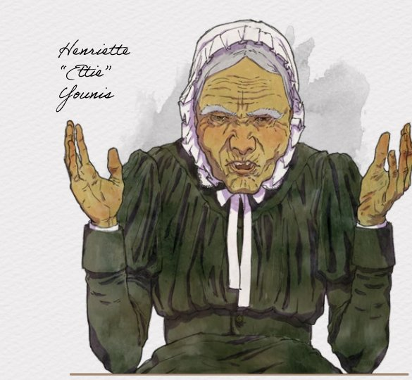

#### Ясновидящая

Пока влюблённые препираются с Коллингвудом, сэр Джаспер Брамли может обратить внимание на мадам Юнис — пожилую любительницу карт с неотвязным кашлем.

Взглянув на карты, Джаспер поймёт, что это не та игра, которую он знает. И неудивительно: медиум на самом деле пытается заглянуть в будущее с помощью своей колоды французских карт.

Этти тоже держится с тревожащей фамильярностью и снисходительно, но, в отличие от Коллингвуда, ей, похоже, нравится держать свои секреты при себе: в ответ на любой вопрос она издаёт раздражающее хихиканье, которое обычно резко обрывается приступом кашля. Если Джаспер или Глэдис сумеют её расположить, старуха может предложить им быстрое гадание и поделиться каким-нибудь тревожным откровением вроде: «В этом замке вы найдёте смерть… и не один раз» — или чем-нибудь в этом роде.

#### Сиделка и её подопечные

Пока всё не пошло наперекосяк, — а это вполне вероятно, учитывая поведение Коллингвуда, — появляется дородная женщина в одежде сиделки, с огромным распятием на груди; рядом с ней идёт слепой мальчик, вцепившийся в её руку. Чтобы сыграть ребёнка, смотрите в одну точку вдаль, на горизонт, и поворачивайте голову на любой источник звука, но избегайте встречаться взглядом с игроками.

*Прим. перев.:* подпись на рисунке — «Henriette», в тексте книги — Henrietta.

Сиделка улыбается преувеличенно широкой улыбкой, зажмуриваясь и надувая щёки. Она усаживает бедного ребёнка в одно из кресел и выходит из комнаты без всяких объяснений.

Мальчик — Виктор Бердетт; на вопросы сыщиков он отвечает механически, заученно и без запинки, словно это ответы на урок, который он вызубрил наизусть: «Меня зовут Виктор Бердетт, и я вундеркинд-пианист, потому что много занимаюсь, не то что моя сестра, которая ленива, как все женщины, и ей не хватает дисциплины и таланта».

Он рассказывает, что родные привезли его в санаторий, чтобы он отдохнул перед конкурсом (что это за конкурс, он так и не объясняет), и что сыграть для них на фортепиано он не может, потому что ему предписан отдых.

Вскоре улыбающаяся сиделка возвращается, толкая скрипучее инвалидное кресло, в котором, откинувшись, сидит кто-то, с головы до пят обмотанный бинтами. Пациент (мужчина это или женщина — понять невозможно) ничего не говорит, лишь хрипло кашляет. Так или иначе, узнать больше сыщики не успеют: Дав открывает двери столовой и просит собравшихся гостей быть так любезны пройти к столу.

### Ужин

Если охотничьи трофеи гостиной впечатлили сыщиков, то предметы, украшающие эту комнату, должны заставить их буквально разинуть рот.

Здесь лорд Дьюар выставляет свои трофеи крупной дичи: огромную голову буйвола, голову тигра, голову льва в обрамлении двух львиц, чёрную пантеру, ягуара, голову внушительного носорога и даже голову слона с гигантскими бивнями прямо за ними — её сыщики видят, лишь обернувшись к двери, через которую вошли. У камина лежит ковёр из белоснежной шкуры огромного белого медведя, а на каминной полке сидит пара экзотических птиц с пёстрым оперением, которых сыщики не узнают.

Освещение в комнате тщательно продумано, чтобы выгодно подчеркнуть роскошные охотничьи трофеи и придать им угрожающий вид.

Сиделка Реддинг усаживает своих пациентов (если только сыщики не взяли маленького Виктора под своё крыло и не заботятся о нём сами), а Дав отодвигает стулья, рассаживая остальных гостей, — начиная, разумеется, с дам, если только Коллингвуд или Уилтшир галантно его не опередят.
