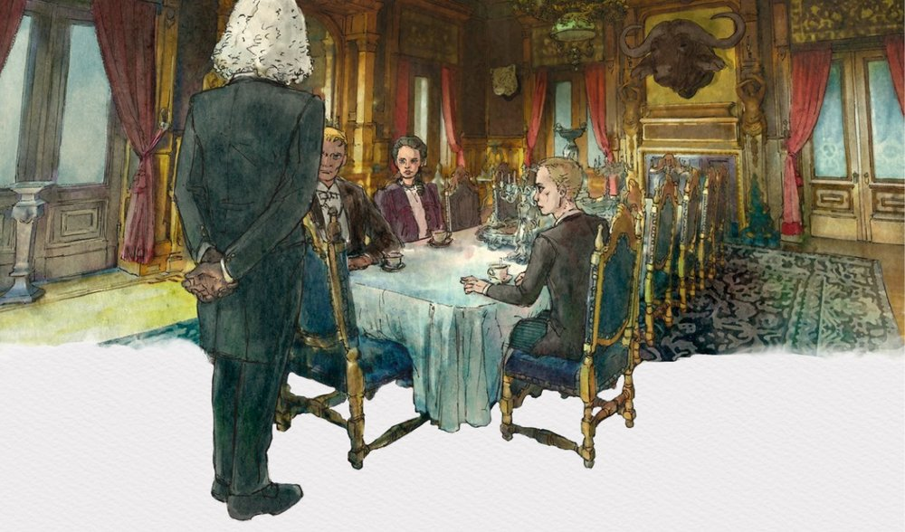
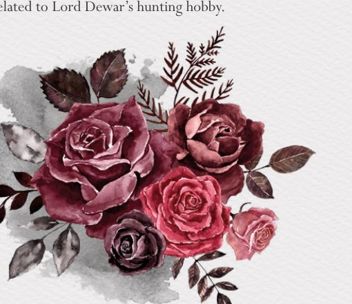

Сыщикам отведены места ближе всего к главе стола, который остаётся незанятым, пока все не рассядутся. Как только все сели, входит лорд Амадеус Дьюар — слегка прихрамывая и опираясь на трость с рукоятью в виде змеиной головы. Рукоятью, которая, к слову, и есть голова настоящей змеи, надлежащим образом засушенная.

Трость важно показать, но не стоит слишком на ней задерживаться. Таксидермия должна служить предлогом, скрывающим настоящую причину, по которой вы её описываете: пусть игроки думают, что это просто колоритная деталь, связанная с охотничьим увлечением лорда Дьюара.

> **Полезный совет**
>
> У меня есть игрушечная трость с серебряной рукоятью в форме головы кобры — я купил её, чтобы играть лорда Дьюара. Она помогает ясно обозначить, когда сыщики имеют дело с этим персонажем, а мне напоминает хромать, входя в роль противника. Это также постоянное, но более тонкое напоминание игрокам, что Амадеус всегда носит трость с собой и никогда с ней не расстаётся, — а в ней, разумеется, спрятана шпага.
>
> Змеиную голову моей трости можно снимать и надевать обратно, и когда я снимаю её в финальной сцене, это производит огромное впечатление. Нечто подобное можно найти в магазине «всё по одной цене» или в магазине карнавальных костюмов по разумной цене, и я очень советую такую раздобыть. Ещё я пользуюсь ею как половником, изображая, будто разливаю суп или помешиваю похлёбку, когда играю молчаливую мисс Милфорд.

