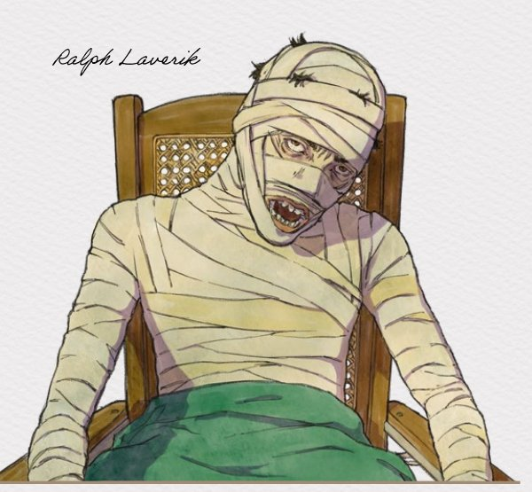

мнимый священник способен лишь открыть глаза и издать несколько гортанных стонов, которые, кажется, умоляют убить его или забрать из этого безумного санатория.

Лорд Дьюар также проявляет большой интерес к здоровью Артура и предлагает сменить ему повязку, а ещё предлагает племяннику лекарство на случай, если рука всё ещё болит.

Однако Дьюар — не единственный присутствующий персонаж Хранителя. Скорее всего, вмешается Коллингвуд, но мадам Юнис или сиделка Реддинг тоже могут вставить своё слово, если разговор коснётся близкой им темы. Загляните в раздел «Темы разговора» в приложениях в конце книги, чтобы понять, о чём ещё можно поговорить за столом после ужина с остальными гостями.

#### Первые проверки

Во время ужина у персонажей будет возможность несколько раз бросить кости, чтобы получить кое-какие сведения. Первая проверка — Внимания с бонусной костью — поможет заметить, что художнику не подали вина, что руки у него иногда дрожат и что, помимо Глэдис Косгроув, он то и дело бросает долгие тоскливые взгляды на бокалы других гостей.

Вторая — Слуха — позволит расслышать сквозь шум разговора звук приближающегося к особняку автомобиля.

Если эта проверка провалена, у них всё же будет возможность бросить кости в последний раз и совершить трудную проверку Внимания, чтобы различить отблеск луча света, который не может быть ничем иным, как фарами автомобиля.

Если после этого открытия сыщики решат найти предлог, чтобы подойти к одному из окон на фасаде особняка (для этого придётся выйти из столовой) и выглянуть, новая проверка Внимания позволит опознать машину, остановившуюся у сада перед домом, как полицейский автомобиль Скотленд-Ярда. Если персонаж продолжит следить, он увидит, как из машины выходит мужчина в сопровождении полицейского в форме и направляется к главному входу замка.

### Неурочный загадочный визит

Сразу после того, как подали второе блюдо, Дав врывается в комнату — с такой поспешностью, какую только позволяют манеры британского дворецкого, — и что-то шепчет на ухо лэрду. Если вашим игрокам не везёт с бросками и вы знаете, что они нетерпеливы, можно позволить им сделать ещё одну проверку Слуха, чтобы различить в шёпоте слово «полиция».

Аристократ выглядит недовольным, и все слышат, как он, хоть и сквозь стиснутые зубы, говорит, что у него гости и он ужинает. Дав незаметно шепчет что-то ещё в ответ, доктор соглашается, и дворецкий выходит из комнаты.

Поднявшись, лорд Дьюар объявляет, что, к сожалению, обязанности благородного человека требуют от него принять неожиданного посетителя и что он надеется, гости простят ему неучтивость, но дело, по-видимому, срочное. Он просит их не беспокоиться и закончить ужин, отказываясь от любой помощи, которую могут предложить сыщики, и объясняет, что это дело, которым не может заняться никто, кроме него. Затем он выходит из комнаты — хромая, опираясь на свою вычурную трость и никуда не торопясь.

Если сыщики слышали шум мотора и затем преуспеют в проверке Идеи или если игроки просто объявят, что их персонажи выглядывают в окно соседней игровой комнаты, они мельком увидят автомобиль Скотленд-Ярда, если ещё не видели его.

#### План доктора

Лорд Дьюар и Дав прекрасно знают, зачем приехала полиция, и любой ценой позаботятся, чтобы та не пересеклась с персонажами. Если персонажи вели себя беспокойно, хозяева будут больше опасаться, что те сделают какую-нибудь глупость, и потому установят за ними
