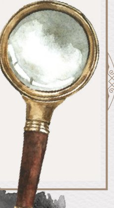

## Миттельшпиль

### Сны

Рано или поздно сыщики решат лечь спать — и тогда начнутся первые кошмары.

Определённых сроков, за которые должен развернуться этот сценарий, нет. Однако задумано так, что сны и их откровения нарастают крещендо — как и переживания игроков, когда они приносят их за стол. Мы бы предположили, что сыщики проведут в замке Дьюар три ночи, прежде чем тема достигнет кульминации. Первая ночь заставит их насторожиться. Вторая может толкнуть их к опрометчивым поступкам, поэтому неплохо, если, проснувшись, они обнаружат, что лэрд уехал на весь день и вернётся только к ночи. Это вынудит их отложить любые планы бросить ему вызов или какое-нибудь драконовское требование, которое могло бы сбить историю с курса. Третья ночь должна стать поворотной точкой, помогающей событиям развернуться. Сны, которые персонажи видят в эту последнюю ночь, скорее откровенны, чем жутки: они дают важные улики для разгадки тайны.

Конечно, кошмары пугают сыщиков не только по ночам. Если кто-то решит вздремнуть, растянуться на одном из шезлонгов в санатории, выпить успокаивающего травяного чая или принять пенную ванну, позаботьтесь, чтобы он поддался власти Морфея и увидел кошмар. По ходу приключения возможностей для таких снов будет всё меньше, а сыщики будут всё неохотнее ложиться спать, так что пользуйтесь любым удобным случаем.

Помимо «универсальных» снов, которые вы можете по своему усмотрению назначить любому из персонажей, не стесняйтесь импровизировать новые кошмары — по мотивам самых тяжёлых переживаний, которые могли выпасть сыщикам, их чувства вины или исходя из того, что вызывающее наибольший страх скорее всего и явится им во сне. Не беспокойтесь и о том, что какие-то сны придётся пропустить, если сценарий стремительно движется к концу: игроки никак не смогут пройти через каждый поворот этого раздела.

Наконец, есть ещё один, последний ингредиент — ни сон, ни галлюцинация, — внезапные и краткие вспышки осознания, которые сыщики переживают, соприкасаясь с запахами, предметами, ситуациями или элементами своей прошлой жизни, — тем, что высвобождает какое-то подавленное воспоминание, прорывающееся сквозь гипноз, которому их подвергает лорд Дьюар. Мрачное ощущение дежавю.

Некоторые из этих «вспышек» предложены в разделе «Места» этого приключения (с. 48). Остальные импровизируйте на ходу, когда сыщики сталкиваются с чем-то, что прямо связано с тем, кем они были, и явно противоречит тому, кем их заставили себя считать.

Нечто подобное происходит с сыщицей, которая играет роль Глэдис, если сёстры Шерман соблазнят Джаспера и она увидит его обнажённым и возбуждённым. В этот момент она может понять, что он не первый мужчина, которого она видит в таком положении, — для неё это привычно, — или даже узнать в теле Джаспера тело любовника, с которым спала; или наоборот — если это Джаспер увидит обнажённую Глэдис.

> **Полезный совет**
>
> Отделять игрока от остальных во время ролевой игры — не всегда хорошая мысль, но для этих снов, по-моему, лучше поступить именно так. Игрок не только будет чувствовать себя уязвимее в одиночестве, но и обычно поделится случившимся со своей группой (так что сведения не потеряются), а делая это, погрузится в точку зрения и отыгрыш своего персонажа — и игра станет напряжённее. То, что персонажи говорят или умалчивают о своём опыте, и то, как остальные члены группы на всё это реагируют, — ещё и прекрасный источник конфликтов между сыщиками.

