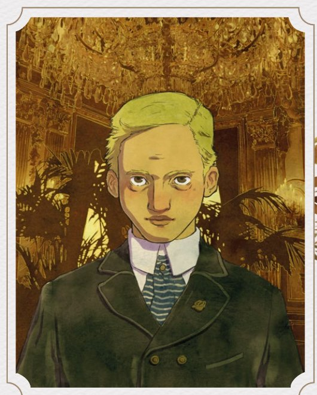

### Кошмары Джаспера

#### Первый сон: драка в джентльменском клубе

В изысканной, избранной атмосфере этого лондонского джентльменского клуба царит покой. Приглушённый свет, невозмутимое спокойствие прислуги, ароматная завеса дыма дорогих сигар, которые курит собравшееся общество, и ленивые разговоры вполголоса — всё это окутывает тебя успокоительным покровом безмятежности.

Хотя публика здесь весьма избранная — женщин и людей с дурной репутацией не принимают, — клуб открыт для состоятельных, уважаемых мужчин из любого уголка земного шара, что придаёт ему космополитический дух, который трудно найти в других, более традиционных кругах британской столицы. В его стенах собираются послы и иностранные консулы, богатые дельцы со всех концов империи, писатели, интеллектуалы, художники и видные лица из самых разных стран мира.

У роскошного камина, за одним из массивных столов, компания джентльменов разных национальностей дегустирует лучшие вина и крепкие напитки и развлекается игрой в карты. Один из них — сэр Джаспер Брамли.

Вечер проходит без происшествий, пока двое игроков одновременно не открывают по три туза в одном и том же круге ставок.

Бельгийский консул раздражённо встаёт из-за стола и с сильным французским акцентом обвиняет итальянского аристократа в шулерстве. Итальянец на родном языке отпускает замечание о покойной родне бельгийца и выплёскивает ему в лицо стакан воды. Немецкий делец пытается схватить его за шею, и тот врезается в стол, который ломается от удара. Бельгийский матрос, полупьяный, поднимается с места, чтобы врезать шулеру, который освободился от огромного немецкого докера ударом колена в пах… И тут ты понимаешь, что ты уже не в изысканном джентльменском клубе, а в грязной таверне у доков, на берегу Темзы.

Но драка продолжается. Итальянский шулер вонзает нож матросу в глаз, и тот издаёт леденящий кровь крик. В этот момент ты понимаешь, что спишь, — но крик, который ты слышал, был настоящим, и он вырывается из горла Артура Уилтшира.

#### Второй сон: жаркая встреча в борделе

И снова воздух полон дыма, но на этот раз он воняет дешёвыми сигаретами. Обои на стенах порваны и местами отслаиваются там, где их не покрывает чёрная плесень; этого не могут до конца скрыть даже красные тюлевые занавески, смягчающие свет.

Коридоры довольно узкие, и пройти по ним трудно, не задев какую-нибудь из парочек, торопливо снующих из комнаты в комнату, или кого-то из работающих здесь девушек в скудном белье, которые пытаются зазвать клиентов внутрь.

Дверь в комнату в конце коридора приоткрыта и поддаётся, когда ты её толкаешь. Девушка стоит за полупрозрачной ширмой, и её силуэт виден против света: она снимает с себя одежду, обнажая тело, и вешает её на ширму, за которой прячется.

Ты разжимаешь кулак и смотришь на металлический кружок, который в нетерпении сжимал изо всех сил. Это твой счастливый пенни, но во сне — а это сон — ты знаешь, что монета каким-то образом означает нечто другое. Это жетон, подтверждающий, что ты заплатил мадам, — он даёт право на время с проституткой. Звон, с которым он падает в металлическую чашу, поставленную для этого на столике у двери, заставляет женщину выйти из-за ширмы.

Ты смотришь на её босые ступни. Пальцы на них уменьшаются по длине изысканно правильно — такую форму называют египетской стопой. Её ноги длинные и подтянутые. Её лоно — в форме тюльпана. Крупные красные соски венчают её необычно упругую и высокую для такого размера грудь. Грудь совершенно
