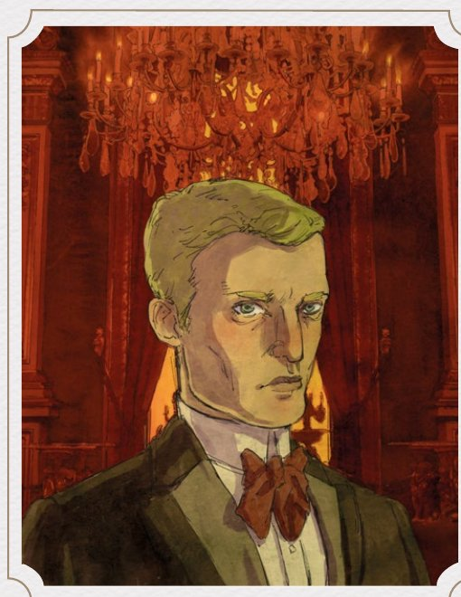
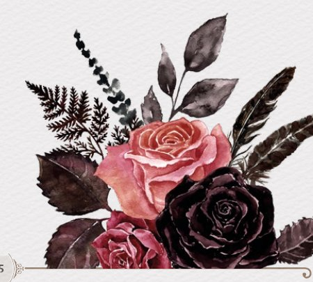

Ты стоишь в конце длинного коридора и вдалеке видишь чудовищную раму приоткрытой двери, из-за которой пробивается свет и доносится крик женщины.

Ты медленно приближаешься и, подходя ближе, начинаешь различать, что происходит в комнате. Там гигантская кровать, а на ней — твоя мать, уткнувшаяся лицом в подушку, плачущая и всхлипывающая.

Но нет, это не кровать большая — это ты маленький. Ты подходишь ближе и видишь задранную юбку матери, закинутую ей на спину; её прижимает волосатая рука, которая держит её одежду и вывернутую руку у неё за спиной. Ты подходишь ещё ближе и видишь её белые ягодицы, нижнюю юбку, спущенную до колен, и волосатую фигуру мужчины, ритмично входящего в неё сзади.

Отступив от двери, ты поднимаешь взгляд и видишь дикое, потное лицо своего дяди, стиснувшего зубы, а мать продолжает скулить от боли.

Тут ты чувствуешь на плече маленькую ладонь. Это Джаспер — он тоже услышал крики и пришёл за тобой из другой комнаты.

Мать начинает кричать громче. Это вопли полного отчаяния — и тут ты понимаешь, что это кричит не твоя мать, а Глэдис, и это уже не сон. Крики настоящие, и они доносятся из соседней комнаты!

#### Третий сон: дуэль

Крест на ближнем монастыре отбрасывает на землю длинную тень. Утренний туман понемногу рассеивается, открывая жемчужины росы на травяном ковре, где ты повторяешь несколько движений перед дуэлью, которая вот-вот состоится. Свежесть рассвета помогает размять мышцы. Джаспер и Глэдис с тобой. Они встревожены и не скрывают этого, но, как говорится, *noblesse oblige*. Есть споры, которые можно разрешить только кровью, — и ты знаешь, что сегодня прольётся не твоя.

Стук копыт и колёс отвлекает тебя от размышлений. Ты видишь экипаж — чёрный, роскошный, с гербом прогнившего рода на дверцах. Твой противник прибыл.

Чернокожий слуга, правящий экипажем, спускается с козел и открывает дверцу. Ты знаешь этого человека. Почему он служит твоему сопернику?

Но из экипажа выходит не молодой аристократ, с которым ты должен был драться, а куда более пожилой джентльмен — хотя в точности того же рода. Это шотландский лэрд, лорд Амадеус Дьюар. Твой дядя!

Вот кого ты должен одолеть на дуэли. Так было всегда.

И с этой уверенностью ты просыпаешься в своей комнате в замке Дьюар.

