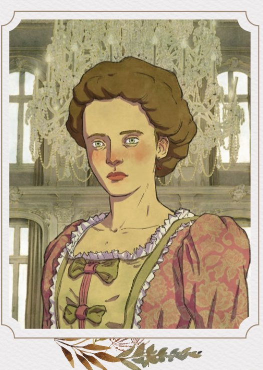

### Кошмары Глэдис

#### Первый сон: премьера в опере

Вечер премьеры, и Королевский оперный театр набит до отказа. Все ложи заполнены, кроме королевской, и все отчаянно надеются, что её почтит своим присутствием сама Её Королевское Высочество — королева Виктория, правительница Соединённого Королевства.

Если она не появится, это не слишком изменит дело. Один лишь слух о том, что она может прийти, уже заполнил театр сливками лондонского высшего общества. Успех твоего премьерного выступления и его отголоски более чем обеспечены, но если бы пришла королева — что тогда?! Это поистине было бы сбывшейся мечтой.

И в этот самый миг ты замечаешь его. Какое-то движение в партере — неприметное, но не оставляющее сомнений: стража британской императрицы осматривает здание. Камергеры выстраиваются в королевской ложе. Знатные дамы и господа встают и поворачиваются к единственно возможному средоточию внимания. Наконец, под бурную овацию всех зрителей, ты видишь, как входит Её Величество королева.

Опера начинается. Сначала речитатив, затем ария, которая начинается каватиной и завершается кабалеттой, где ты можешь показать подлинные возможности своего голоса. Спеть последнюю часть на октаву выше, чем написал композитор, — риск, на который мало кто отважится; на репетициях это удавалось тебе не всегда, но нужно воспользоваться присутствием королевы. Ты должна рискнуть! Ты закрываешь глаза, набираешь полную грудь воздуха и бросаешься в финальную партию. Ты не смеешь смотреть; ты целиком и полностью сосредоточена на пении. Ты подходишь к самым высоким нотам, и горло берёт их с нежностью соловья. Последняя нота долго замирает, её эхо отдаётся от стен театра. Все молчат, а ты не открываешь глаз. Ноги дрожат, но на лице расцветает робкая улыбка.

Тишина длится, и длится, и длится, пока…

Наконец её нарушают первые робкие, удивлённые хлопки, за которыми тут же следует громовая овация. Всё больше голосов присоединяется к восторженным крикам: публика пробуждается от чар и понимает, что только что стала свидетелем чуда. Браво!! Прекрасно! Божественно! Чудесно! Изумительно! Великолепно! Восхитительно! Ты сияешь ярче солнца! Ну и пара сисек, Господи Иисусе! Платье тебе к лицу, а был бы я у тебя на груди — я бы тоже на тебя кончил! Иди сюда, дай попробовать твои сиськи, сука! Спускайся, я дам тебе то, чего ты заслуживаешь! Раздевайся, шлюха!

Ты открываешь глаза и обнаруживаешь, что ты не в Королевском оперном театре. Ты в грязном кабаре-притоне, полном дыма и пьяных, и некоторые из них, похоже, чересчур возбудились от твоего выступления и пытаются влезть на сцену.

Первого, может быть, удастся остановить, резко пнув его носком туфли в лицо, но другие уже начали взбираться по боковым ступенькам, хотя кое-кто из мужчин труппы пытается их удержать — без особого успеха. Спрятаться между задниками кажется лучшей мыслью, но для этого придётся пройти мимо обезумевших маньяков, которые не сводят глаз с тебя — предмета своего вожделения. Одному из них удаётся схватить тебя за платье и дёрнуть, не давая уйти. Как ты ни вырываешься, мужчина не отпускает, а ткань не рвётся.

Ты просыпаешься как от толчка и замечаешь, что запуталась в простынях. Никто не тянет тебя за платье. Ты одна, в своей спальне в замке Дьюар.

Переведя дух и поняв, что всё это был кошмар, ты слышишь крик Артура из соседней комнаты.
