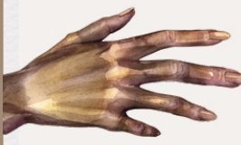

Зеркала крепятся к потолку телескопическими шарнирными трубками, которые можно настроить так, чтобы показать каждому пациенту череду искажённых, изломанных отражений его самого со всех возможных сторон.

Когда оборудование проверено, а подопытный привязан к ложу, сиделка Реддинг делает укол, от которого сознание отделяется от тела, а сердце останавливается. Свет в комнате становится ярче и отражается в зеркалах, совершенно ослепляя подопытного кролика. Эта процедура отнимает 1D3 пункта здоровья, и с этого момента в каждой сцене, где сыщик исследует загробный мир, он обязан совершить проверку ВЫН и при провале теряет ещё 1 пункт здоровья.

> **Полезный совет**
>
> Если на протяжении игры у вас звучала музыка, здесь резко остановите её и дайте игроку погрузиться в тишину. Мне очень трудно одновременно вести игру и управлять музыкой, поэтому я обычно ставлю одну и ту же мелодию на повтор на всё время: постоянное повторение порождает подсознательное ощущение клаустрофобии, которое позволяет выжать максимум из эффекта, когда вы останавливаете музыку и погружаетесь в мир мёртвых.

##### Мир за завесой

Подопытный просыпается на другом берегу Стикса — реки, отделяющей мир живых от мира мёртвых. Он всё в той же комнате, но промок насквозь, и ему становится всё холоднее. Зеркала машины сияют ослепительным светом, так что в них невозможно смотреть. Остальные предметы в комнате те же, только утратили подробности. Будто разум воссоздаёт обстановку по памяти, но не может ни вообразить ничего нового, чтобы заполнить недостающее, ни вспомнить абсолютно всё. Текстуры грубые, гладкие, повторяющиеся. Зрение сыщика совершенно ясное, но всё стало проще, грубее. В комнате больше никого нет, и сыщик не может взаимодействовать ни с какими предметами. К счастью, дверь по-прежнему открыта.

На самом деле в загробном мире всё равно, открыта дверь или закрыта. В астральном облике сыщик не может её сдвинуть, но проходить через неё и не нужно, так что она не представляет никакого препятствия — если только он не верит, что представляет.

Если спросить игрока, что он делает, и он скажет, куда идёт, он обнаружит, что способен почти мгновенно переместиться в это место, не преодолевая пешком расстояние до цели. Эта способность включает и прохождение сквозь любую дверь или преграду между ним и целью. Однако игрок должен догадаться об этом сам.

Ещё одна бросающаяся в глаза особенность этого загадочного призрачного царства — полное отсутствие звуков. Нет никаких фоновых шумов, и сыщики не могут издать ни звука — ни криком, ни ударом по чему-либо.

Пока сыщик исследует земли за завесой, у него будет возможность наблюдать сцены, запечатлённые в коллективном бессознательном человечества (по крайней мере так объясняет им доктор Дьюар), которые лэрд окрестил «отпечатками». Эти сцены возникают из ниоткуда и рассеиваются как дым, когда заканчиваются, — совсем как воспоминание, связанное с местом.

Из практических соображений мы собрали все отпечатки в разделе «Места» этой главы (см. с. 48). Они приводятся в конце описания каждого из мест, упомянутых в тексте.

Если игроки решат отправиться в такое место особняка, для которого отпечатка нет, у вас четыре варианта: импровизировать его; привести их на протяжении сцены к ближайшему месту, где отпечаток есть (или перенести действие туда); вернуть сыщика в страну живых; или просто сказать, что никакого отпечатка там не будет. Если решите импровизировать, учтите, что воспоминание не обязательно должно быть связано с приключением или эпохой персонажей. Например, они могут увидеть кельтскую свадьбу, сыгранную на этом самом месте более двух тысяч лет назад. Помните, однако, что у любого видения должна быть достаточная эмоциональная сила, чтобы оно запечатлелось в коллективном бессознательном.
