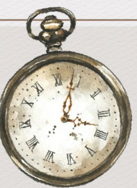

#### «Наука», стоящая за исследованием

Машина Харона — одна из опор эксперимента доктора Дьюара, но на самом деле исследование загробного мира — не самоцель, а лишь инструмент для подлинного замысла лэрда: вернуть своих любимых к жизни.

Единственный способ обеспечить перемены, которые хочет произвести доктор, — синергия, одновременно преображающая тело, разум и дух; она позволит ему завершить переселение умерших в новые живые тела.

Машина создаёт портал между миром живых и миром мёртвых. Пока сыщики исследуют этот мир, они пропитываются остаточными частицами духов мёртвых. Они словно маяк, мощный магнит, притягивающий души павших. Это двусторонний портал, и, возвращаясь в страну живых, сыщики приносят с собой какие-то следы этих душ, которые иначе не смогли бы перейти.

Однако тело тоже должно быть заменено — и внешне, и по составу. Души помнят свои тела, и это помогает им вернуться и остаться.

Вот почему лорд Дьюар употребил свой талант хирурга и таксидермиста, чтобы преобразить лица сыщиков, стараясь как можно ближе уподобить их лицам своих любимых. Результаты далеки от того, что можно назвать чудесным, и некоторые шрамы всё ещё хорошо заметны, но гипноз, которому подверг их Дьюар, не даёт им этого осознать. Несмотря на скальпель, другие люди — например, полицейские из Скотленд-Ярда — всё ещё без особого труда узнают в сыщиках тех, кем они являются на самом деле, а людей, знавших родных лорда Дьюара при жизни, — например, ловцов крабов, — такой грубой хирургией не обмануть.

Это что касается внешности. Что же до состава тела, лорд Дьюар скармливает сыщикам телесные останки Артура, Глэдис и Джаспера, которые он сохранил в составе собственного изобретения в погребе замка.

И снова именно гипнотические внушения Дьюара не дают сыщикам заметить, что то, что они едят, — человеческая плоть; лишь изредка эта стратегия на несколько коротких мгновений даёт сбой.

Наконец, лорд Дьюар делает всё возможное, чтобы привести в созвучие духи сыщиков и духи людей, которых он хочет вызволить из царства Аида. В некоторых случаях такое созвучие требует более радикального разрушения личности. Научить манерам шайку головорезов вроде этих, заставить их приобрести умения и таланты, которыми обладали их предшественники, и сменить их порочную натуру на более утончённую оказывается труднее и требует от лэрда больше терпения, чем он ожидал. Это титанический труд, который не будет завершён в одночасье, но доктор доволен тем небольшим продвижением, которого он в этом добивается.

Кто-то мог бы подумать, что проще — или по крайней мере менее опасно — использовать как сосуды людей из более образованного сословия или хотя бы не закоренелых преступников. Конечно, исчезновение наследника знатного аристократического рода вызвало бы переполох и беспокойство властей, чего Дьюар допустить не может; но кто хватится молоденькой служанки с хорошими манерами и добрым нравом? Все решат, что она сбежала с пригожим садовником, и никто не задумается дважды. Беда такого подхода в том, что методы мысленной обработки доктора гораздо лучше действуют на людей с расстроенной психикой — тех, кто глубоко отвергает самих себя и то, во что превратился. На людей, которые хотели бы стать кем-то совершенно другим, если бы могли выбирать.

Это подсознательное отвращение к себе и отсутствие самоуважения необходимы, чтобы гипноз Дьюара проник в психику жертвы и укоренился в ней. Как ни извращённо это звучит, Дьюар предлагает им возможность пережить перемену, о которой они в глубине души мечтают.

Лорд Дьюар не знает точно, какова природа мира, который он исследует, и, откровенно говоря, раскрытие его тайн волнует его куда меньше, чем возвращение любимых к жизни. Он не уверен, переселяются ли души и воспоминания в этот мир мёртвых, когда умирает тело, или они медленно просачиваются в него на протяжении всей жизни. Однако у него сложилось впечатление, что этот своего рода коллективный бессознательный слой, состоящий из воспоминаний, напоминает хранилище, где дух умершего пребывает в состоянии оцепенения, а не рай или чистилище, где он мог бы и дальше существовать сознательно, независимо и деятельно. Так или иначе, все теории, которые могут быть у доброго доктора на этот счёт, не имеют значения для ведения этого сценария.
