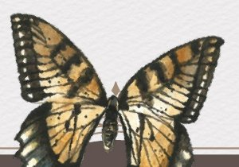

из мифологии кечуа. Пять из них легко опознать как изображения видных богов инкской традиции, и потому их легко узнать, но последняя маска была совершенно неизвестна, и её не удалось сопоставить ни с одним божеством андской истории — по крайней мере, сколько-нибудь убедительно.

Первая из масок соответствует Виракоче: творцу, отцу, которому поклонялась инкская знать. Это божество сопровождает птица, знающая настоящее и будущее. Эту вещь венчает хищная птица с распростёртыми крыльями, и потому её легко опознать. Кроме того, у маски солнечный ореол, длинная борода и золотые слёзы (по легенде кечуа — начало дождя), текущие из семи глаз лица (ими бог видел всё), так что не остаётся и тени сомнения, какого бога изображает маска.

Вторая маска изображает Маму Килью, мать-луну. Это божество — мать небосвода и покровительница женщин, которые поклонялись ей на большом празднике в её честь. Она была богиней брака и месячного цикла. Опознать эту маску просто: это единственная из вещей с серебряной отделкой — в виде слёз, похожих на слёзы, которые, по мифологии кечуа, проливала богиня.

Третья вещь связана с божеством Пачамамой, олицетворяющей землю и пропитание, которое она даёт. Она управляет земледельческим циклом, и её легко узнать по женственному, детскому облику и цветку коки, венчающему волосы.

Четвёртая маска, вероятно, принадлежит Пачакамаку, хозяину и владыке землетрясений, которого верующие описывали как бога без кожи и костей. Лицо — голый череп, что ясно указывает на связь с этим божеством, которого больше боялись, чем любили. Есть вероятность, что эта вещь посвящена богу Кону, хотя, если бы хотели изобразить его, наверняка повторили бы его кошачьи черты с большими глазами, а не череп.

Пятое изваяние — Мама Коча, божество открытого моря и доброго улова. Маска щеголяет волнистыми волосами, подражающими морским волнам, в которых изображены раковины, рыбы, гребешки, морские звёзды и другие подобные мотивы.

Шестая и последняя маска не связывается ни с одним из известных богов инков. Если сыщики попробуют заговорить об этом с лордом Дьюаром, тот в конце концов предположит, что это неканоническое изображение Инти, бога солнца, или, может быть, Ильяпы, бога молнии и войны, — хотя к этому выводу он пришёл скорее методом исключения и по значимости названных божеств, чем по виду самого лица. Маска, похоже, изображает больное лицо, покрытое беспорядочными шрамами, не образующими никакого узора, нарывами, гнойниками и даже рожками или шипами, разбросанными по лицу как попало. Нос искривлён, словно сломан в нескольких местах, и с него свисают длинные свечи. Запавшие глаза неровные, совершенно несимметричные и сидят на разной высоте.

*Прим. перев.: «длинные свечи» — так в английском тексте; вероятно, это буквальный перевод испанского «velas», которое в разговорной речи значит и «свисающие из носа сопли».*

Кроме того, к этой коллекции прилагаются расписные глиняные и деревянные сосуды, церемониальные ножи (туми), серебряные браслеты и глиняные фигурки (конопы) — например, в виде злаков и жвачных животных. Денежная ценность этих предметов сравнительно невелика, поэтому подробнее о них говорить не стоит.

#### Поддельное сокровище

Лорд Дьюар воспроизвёл в гипсе только три маски из шести. Внутрь он вложил свинцовый сердечник, а затем покрыл их золотой краской — это обманет лишь тех, кто находится под его психическим влиянием, как сыщики.

Будь масок больше, группа могла бы решить попытать счастья и сбежать с добычей, накопленной к этому времени. Разумеется, в том маловероятном случае, если им удастся покинуть поместье, их ждёт неприятный сюрприз: украденное сокровище не стоит ровным счётом ничего, — но лорду Дьюару это никак не поможет. Лучше не рисковать и всегда оставлять воров слегка голодными.

> **Примечание для Хранителя**
>
> Какие из масок поддельные, решать вам — если эта подробность важна кому-то из персонажей, в чём я, честно говоря, сомневаюсь. Мой совет, конечно, — чтобы хотя бы одна из них изображала загадочного забытого бога: это усилит страх героев.
