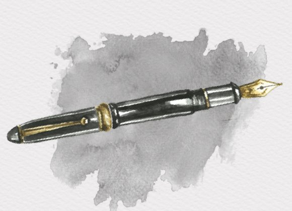

Сведения о доколумбовом сокровище дошли до сыщиков через агентов лорда Дьюара — скорее всего, Дава или сиделку Реддинг. Они позаботились о том, чтобы слух о существовании сокровища разошёлся по тёмным закоулкам британской столицы, заманивая в особняк новых подопытных для доктора. Внушить мысль о проклятии крайне важно: это порождает в их умах страх и подсознательную подозрительность к маскам. Так они не станут разглядывать маски слишком пристально, и подделка не раскроется сразу.

Как уже говорилось, маски сокровища инков — предметы, которые лорд Дьюар может разместить где ему угодно, а точнее, вы, Хранитель, можете положить их туда, где это удобно вашей группе. Сыщики могут найти их и в тайных катакомбах лэрда — ещё до того, как он успел разложить их по дому и поместью, — если так игра станет интереснее. Самые обычные места для этих подделок: тайник в рояле, во чреве одной из химер (лучше всего херувима), пустая ниша в семейном мавзолее, внутри одних из часов в игровой комнате, в пустом черепе одного из охотничьих трофеев в столовой или комнате ожидания, какой-нибудь тайник среди хлама в подвале, в древних римских банях в лесу или в одной из пещер в скалах.

Лорд Дьюар может приказать спрятать любую из поддельных масок в одном из этих мест, если опасается, что гости потеряли всякую надежду найти сокровище и, возможно, замышляют побег из замка. Этот ход ему не особенно по душе: он поощряет преступные наклонности в характерах сыщиков — а именно их он и пытается искоренить. И хотя так он рискует подпитать эту склонность, если сочтёт себя вынужденным, он это сделает, видя в этом меньшее зло, которое успеет исправить позже.

### Музыкальная шкатулка

Второй замысел лорда Дьюара связан с подделками музыкальной шкатулки Фиделии Уилтшир. Оригинал погиб при пожаре, но лэрд заказал несколько копий этой вещицы и связал её мелодию с мощным гипнотическим внушением, из-за которого сыщикам кажется, что они заперты в той комнате, где в этот момент находятся.

Пока играет музыка, любые попытки открыть окна или двери бесполезны. Выходы словно заперты. Если сыщики попробуют выбить оконное стекло стулом, окажется, что оно не поддаётся никаким ударам (на самом деле их разум останавливает движение до удара, но они будут убеждены, что изо всех сил ударили по стеклу). Если они попытаются взломать замок или у них есть подходящий ключ, тот внезапно не сработает, и так далее.

Кроме того, если шкатулка у персонажей под рукой, они не смогут ни открыть, ни закрыть её, ни как-либо повредить. Это дополнительная мера безопасности, не дающая персонажам вырваться, просто разбив источник назойливой мелодии. Как только музыка смолкает, двери и окна снова открываются как обычно, и сыщики не смогут найти никакого объяснения беспомощности, которую испытали всего несколько мгновений назад. Если персонажи упомянут об этом лорду Дьюару или Даву, те отнесутся к случившемуся как к пустяку и скажут, что двери и окна иногда немного заедает и обычно это исправляет пара капель масла.

Музыкальные шкатулки очень маленькие — не больше портсигара; это сравнение точнее, чем с любым другим предметом с обеденного стола. Они помещаются на ладони, и их удобно носить в любом большом кармане. Именно маленький размер вместе с затейливой филигранью и вправленными в них красивыми камнями и делает их дорогими. Цена, впрочем, всё равно недостаточна, чтобы покрыть долги группы, даже если бы им удалось заполучить все тридцать копий, что есть у доктора.

Лорд Дьюар, Дав и сиделка Реддинг всегда носят при себе по копии, и ещё несколько могут быть спрятаны в замке — если вам удобно запереть персонажей или, что вероятнее, если так их будет легко найти.

С точки зрения Хранителя главное назначение этих игрушек — не столько удерживать сыщиков в комнате, сколько создавать ощущение тревоги и тайны. Самый очевидный способ этого добиться — необъяснимое действие мелодии: услышав её, персонажи всякий раз оказываются в ловушке. Но это не единственный способ. Загадку самой музыкальной шкатулки (помните, что персонажи думают, будто она одна) можно обыграть и многими другими
